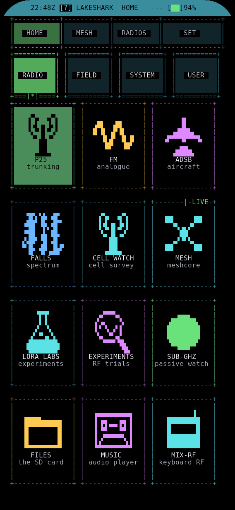
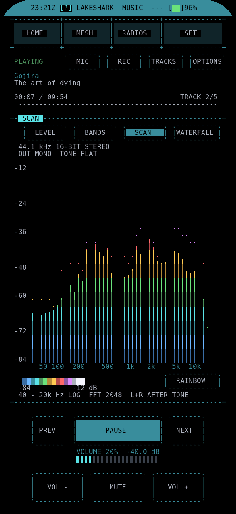
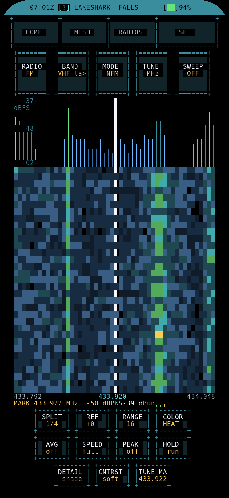
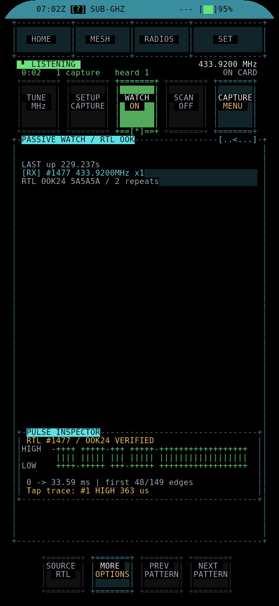
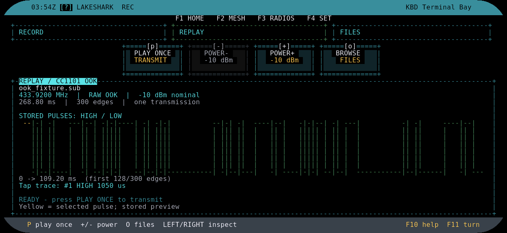
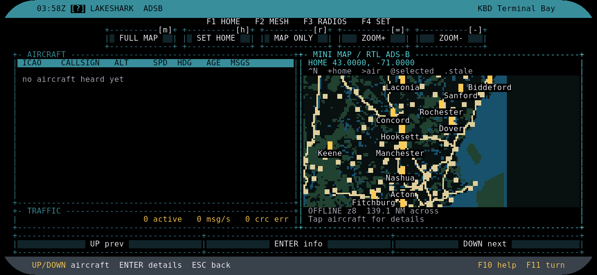
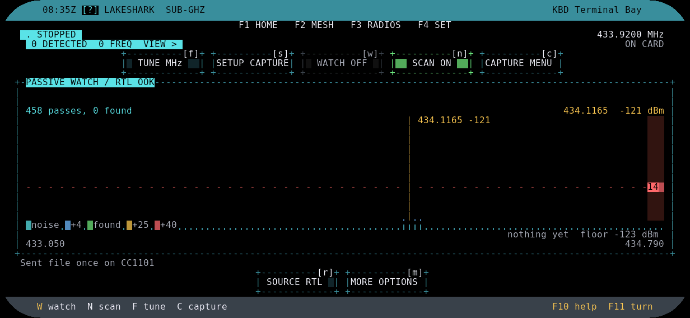
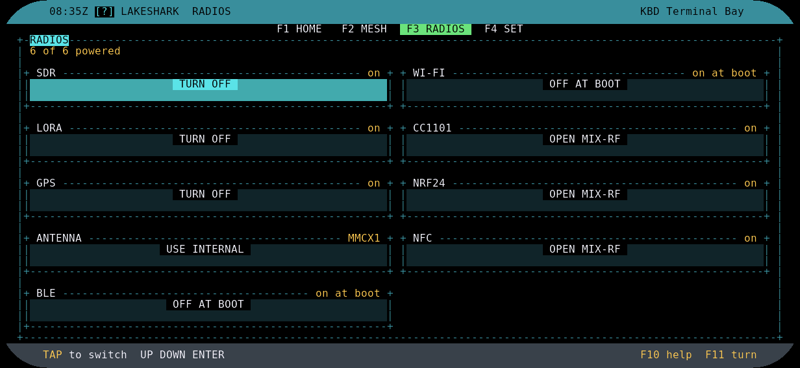

<div align="center">


### A handheld SDR. Powered by a LoRa chip, RTLSDR, and HackRF.

**P25 Digital Voice · FM Radio · ADS-B Aircraft · Pagers · MeshCore · RF Tools**

Turn the [LILYGO T-Display P4](https://lilygo.cc/en-us/products/t-display-p4) into an open-source handheld radio multitool.

**[Install LakeShark](https://terminalbay.com/?m=lakeshark)** &nbsp;•&nbsp;
**[See it in action](https://terminalbay.com/?m=lakeshark-showcase)** &nbsp;•&nbsp;
**[Documentation](https://terminalbay.com/?m=wiki)**

---

## A LoRa chip. A whole new radio.

**The onboard LR2021 does more than LoRa. No external SDR required.**

| DIGITAL VOICE | AIRCRAFT | SIGNALS |
| :---: | :---: | :---: |
| **P25 Phase I** | **1090 MHz ADS-B** | **FM + POCSAG** |
| Hear digital radio | Track aircraft live | Listen, decode and visualize |

**Raw I/Q capture · Live waterfalls · Software demodulation · Experimental I/Q transmission**

LakeShark pushes the LR2021 beyond conventional LoRa, using its raw signal path for software-defined reception, decoding and waveform experiments.

**[Explore LR2021-SDR →](https://github.com/SAMS0N1TE/lr2021-sdr)**

[P25 decoding](https://github.com/SAMS0N1TE/lr2021-sdr/blob/main/docs/p25.md) &nbsp;•&nbsp;
[Signal capture](https://github.com/SAMS0N1TE/lr2021-sdr/blob/main/docs/voice-capture.md) &nbsp;•&nbsp;
[Experimental I/Q TX](docs/LR2021_IQ_TX.md)

---

**NEW IN v2.13**

Onboard narrowband FM · Animated VFD meters · Inline keypad · Live I/Q waterfalls

[Release notes](https://github.com/SAMS0N1TE/LakeShark/releases/tag/v2.13.0) &nbsp;•&nbsp;
[All releases](https://github.com/SAMS0N1TE/LakeShark/releases)

</div>

## Choose your hardware

LakeShark runs on both the **LR2021** and **SX1262** T-Display P4 variants. The LR2021 unlocks SDR-like reception directly through the onboard chip.

| Hardware | Capabilities |
| --- | --- |
| **T-Display P4 + LR2021** | Onboard P25 voice, FM, ADS-B, pagers, MeshCore and LoRa tools |
| **T-Display P4 + SX1262** | MeshCore, LoRa and POCSAG. Add an RTL-SDR for FM, P25 and ADS-B |
| **RTL-SDR Blog V3/V4** | External SDR reception, P25 Phase I trunking and sub-GHz captures |
| **MIX-RF keyboard** | Optional physical controls, CC1101, nRF24 and NFC |

## Get started

<div align="center">

### Flash directly from your browser.

**[Install LakeShark →](https://terminalbay.com/?m=lakeshark)**

[First flash guide](https://terminalbay.com/?m=wiki#tdp4/TDP4_FIRST_FLASH) &nbsp;•&nbsp;
[Latest firmware](https://github.com/SAMS0N1TE/LakeShark/releases/latest)

</div>

1. **Select your board.** The primary build supports the T-Display P4 with the 4.1-inch 568 × 1232 AMOLED and 16 MB flash, with either onboard radio variant.
2. **Flash from Chrome or Edge.** Open the browser installer on a computer, choose your board and follow the setup guide.
3. **Explore the airwaves.** Open FM, P25, ADS-B or MESH and connect an antenna suited to your target frequency.

**Already installed?** Use the built-in **UPDATE** app for one-tap Wi-Fi updates. Versions 2.8 and earlier require one USB update first.

> **Power note:** Power the T-Display P4 through its own USB-C input. Do not feed the keyboard's 5V USB output back into the P4. Testing caused repeated power cycling, even without an RTL-SDR attached. Battery-powered RTL-SDR operation and the custom case are still under development.

<div align="center">

### Handheld case development

**[View the latest case renders →](https://terminalbay.com/?m=lakeshark-showcase#renders/01)**


[Wiki](https://terminalbay.com/?m=wiki) &nbsp;•&nbsp;
[Showcase](https://terminalbay.com/?m=lakeshark-showcase) &nbsp;•&nbsp;
[Roadmap](https://terminalbay.com/?m=lakeshark-roadmap) &nbsp;•&nbsp;
[Suggest a feature](https://terminalbay.com/?m=lakeshark-roadmap#ask)

</div>

---

<h2 align="center">}<((((-- Meet the LakeShark</h2>

<p align="center">
  
</p>

<div align="center">

**LILYGO T-Display P4 · 4.1" AMOLED · ESP32-P4 · LR2021 or SX1262**

Touchscreen operation, GPS, motion sensing and an optional detachable MIX-RF keyboard.

</div>

<p align="center">










</p>

## Applications

Everything runs on the handheld. No separate computer is required for normal operation.

### Radio and signal decoding

| App | Features |
| --- | --- |
| **P25** | Phase I trunking and conventional digital voice, automatic/manual demodulation, channel lists, DMR activity view and call archive. Phase II `[EXPERIMENTAL]` |
| **FM** | Analog FM/AM, band scanning, mixed P25/FM channel lists, POCSAG, CTCSS/DCS, APRS, AIS and SAME/EAS alerts |
| **ADS-B** | 1090 MHz aircraft tracking, traffic history, offline mini map, remembered home and spoken aircraft notifications |
| **FALLS** | Live P25, FM and LoRa waterfalls with touch-to-tune markers |
| **CELL WATCH** | Cellular band survey |

### Mesh and LoRa

| App | Features |
| --- | --- |
| **MESH** | MeshCore messaging, node discovery, notifications, spoken messages, route inspection and node telemetry |
| **LORA LABS** | Direct radio controls, packet visualization, signal history and compass |

### Sub-GHz and RF tools

| App | Features |
| --- | --- |
| **SUB-GHZ** | Read, analyzer, saved captures, raw recording, learning and settings. OOK/FSK replay `[EXPERIMENTAL]` |
| **REC** | Signal capture, `.sub` export, playback, inline power and animated waveforms |
| **MIX-RF** | Keyboard CC1101 energy monitoring, nRF24 activity scans and NFC detection |
| **NFC** | MIFARE Classic 4K reads, block maps, key entry, hex/ASCII viewing and saved dumps. Mini/1K full reads `[EXPERIMENTAL]` |
| **EXPERIMENTS** | LR2021 radio experiments including RS41 sondes and LR433 sensors with history and saved readouts `[EXPERIMENTAL]` |

### Mapping and navigation

| App | Features |
| --- | --- |
| **MAP** | Offline maps, aircraft trails, Mesh nodes, ships, APRS, GPX routes, layers, markers and eight palettes. Pixel field view `[EXPERIMENTAL]` |
| **COMPASS** | Tilt-compensated heading, true north, transmitter finding, channel scanning, dual-radio monitoring, hit logs, RADAR and HEAT views |
| **GPS** | Position, navigation and GPX track recording |
| **NOTES** | SD-card Markdown notes with checklists and live GPS, heading and radio information |

### Media and system

| App | Features |
| --- | --- |
| **MUSIC** | SD-card audio playback, VFD meters, octave bands, spectral analyzer, waterfall and microphone visualization |
| **FILES** | SD-card file browsing, sorting, `.sub` previews and direct recording playback |
| **UPDATE** | One-tap signed firmware updates over Wi-Fi |
| **SET** | Display brightness, themes, fonts, sounds, speech and daylight mode |
| **RADIOS** | Radio power, antenna selection and Wi-Fi/Bluetooth startup controls |
| **LINK** | Wi-Fi/Bluetooth scanning, signal graphs and GPS-tagged CSV surveys |
| **DIAG** | Memory, radios, sensors, rebuild statistics and diagnostic logs |
| **TERMINAL** | On-device console with keyboard input |

---

## Scanning, replay and aircraft tracking

<div align="center">

Capture signals, inspect transmissions, replay recordings and track aircraft without leaving the handheld.

**[Technical details →](docs/REPLAY_AND_AIRCRAFT.md)**

| RECORD replay | ADS-B mini map |
| :---: | :---: |
|  |  |

| SUB-GHZ scan | Radio startup controls |
| :---: | :---: |
|  |  |

</div>

The [LakeShark web tools](https://terminalbay.com/?m=lakeshark) also generate P25 profiles, GPS scan lists, channel memories and offline map tiles.

**CartoTUI integration:** LakeShark is designed to work with [CartoTUI](https://github.com/SAMS0N1TE/CartoTUI), my terminal-based ASCII mapping project. Integration is still in development and has not been validated against recent firmware changes.

<div align="center">


[Browser installer](https://terminalbay.com/?m=lakeshark&board=tdp4) &nbsp;•&nbsp;
[First flash guide](https://terminalbay.com/?m=wiki#tdp4/TDP4_FIRST_FLASH)

</div>

### Board notes

- Default target: **568 × 1232 RM69A10 AMOLED, 16 MB flash**.
- For the HI8561 TFT (540 × 1168), add `boards/t_display_p4_tft.defaults` after `boards/t_display_p4.defaults`.
- The LCD-4.3 image uses a different board and 32 MB partition layout.
- LINK requires compatible ESP-Hosted firmware on the ESP32-C6. Factory ESP-AT firmware is not supported.
- T-Display P4 Flipper control uses Bluetooth.

---

## More ways to run LakeShark

### Headless ESP32-P4

The **Waveshare ESP32-P4-NANO** and **ESP32-P4-WIFI6** support headless operation with the same receivers.

Control them through a serial console or a Flipper Zero. Useful for portable radio nodes, remote installations and setups without a display.

### Flipper Zero control head

<div align="center">

**Your Flipper becomes the display and controls. LakeShark handles the radio.**

The [LakeShark-Flipper app](https://github.com/SAMS0N1TE/LakeShark-Flipper) connects over Bluetooth or GPIO.

| | |
| :---: | :---: |
|  |  |
| Offline aircraft map | ADS-B traffic |
|  |  |
| App launcher | P25 radio |

**[Flipper setup guide and screenshots →](https://terminalbay.com/?m=wiki#flipper/Home)**


</div>

The Flipper advertises its connection and the radio connects automatically, without a pairing code.

### Waveshare Touch-LCD-4.3

The original 480 × 800 version is still available for existing hardware, although development now focuses on the T-Display P4.

[Install LCD-4.3 firmware](https://terminalbay.com/?m=lakeshark&board=lcd43) &nbsp;•&nbsp;
[Quick start](https://terminalbay.com/?m=wiki#lcd43/LCD43_QUICKSTART)

The Touch-LCD-4B and Smart 86 Box also have source builds at 720 × 720.

---

## Experimental features

The following features are still being developed or require additional live-RF validation.

| Feature | Status |
| --- | --- |
| **P25 Phase II** | Manual and automatic grant following. Bench-tested with public recordings; live RF unverified. Disabled after restart. [Details](docs/P25_PHASE2.md) |
| **HackRF One** | Experimental SDR support for FM, POCSAG, ACARS, P25, recording and ADS-B. Pagers verified; live P25 unconfirmed. [Status](docs/HACKRF_BRINGUP.md) |
| **LR2021 I/Q TX** | Custom short waveform transmission with amplitude and phase preserved, including P25 test tones and temperature packets. [Research](docs/LR2021_IQ_TX.md) |
| **LoRa bearing plots** | RSSI grouped by compass heading. Not a validated direction-finding system |
| **Location scanning** | Mixed P25/FM lists, GPS filtering and CSV/JSON import. [Details](docs/LOCATION_SCAN.md) |
| **RadioReference adapter** | Requires an approved API key and Premium account. Live authentication not yet verified |

---

## Build from source

LakeShark uses the pinned **ESP-IDF 5.4.3** SDK.

**[SDK setup →](sdk/esp-idf-5.4.3/README.md)**

Use a separate build directory for each target.

```sh
# T-Display P4 AMOLED
idf.py -B build_tdp4 -D SDKCONFIG=build_tdp4/sdkconfig -D SDKCONFIG_DEFAULTS="sdkconfig.defaults;boards/t_display_p4.defaults" build

# T-Display P4 TFT
idf.py -B build_tdp4_tft -D SDKCONFIG=build_tdp4_tft/sdkconfig -D SDKCONFIG_DEFAULTS="sdkconfig.defaults;boards/t_display_p4.defaults;boards/t_display_p4_tft.defaults" build

# Waveshare P4 headless
idf.py -B build_nano -D SDKCONFIG=build_nano/sdkconfig -D SDKCONFIG_DEFAULTS="sdkconfig.defaults;boards/nano_headless_ble.defaults" build

# Waveshare LCD-4.3
idf.py -B build_lcd43 -D SDKCONFIG=build_lcd43/sdkconfig -D SDKCONFIG_DEFAULTS="sdkconfig.defaults;boards/lcd43_gui.defaults" build
```

Build notes:

- `boards/` contains target defaults and partition layouts.
- `main/idf_component.yml` pins dependencies.
- The Waveshare BSP includes patches under `managed_components/`.
- Use a fresh build directory when changing machines or board targets.

Run the host verification checks:

```powershell
pwsh -File bench/verify.ps1 -Level host
```

---

## Credits and open-source projects

LakeShark is built on open-source software, published research and hardware documentation from many developers.

| Project | Contribution |
| --- | --- |
| [rtl-sdr / librtlsdr](https://osmocom.org/projects/rtl-sdr) | Osmocom. RTL-SDR driver foundation. GPL-2.0+ |
| [xtrsdr](https://github.com/XTR1984/xtrsdr) | XTR1984. ESP32-optimized librtlsdr implementation, essential to this project |
| [OP25](https://github.com/boatbod/op25) | Pavel Yazev's fixed-point `imbe_vocoder`. Experimental Phase II work by Max H. Parke, Graham J. Norbury and contributors. GPL-3.0+ |
| [libmodes](https://github.com/watson/libmodes) / [dump1090](https://github.com/antirez/dump1090) | Thomas Watson and Salvatore Sanfilippo. Mode S decoder lineage. BSD-2-Clause |
| [ADS-B Scope](https://github.com/jstockdale/T-Display-P4/tree/adsb) | John Stockdale and Off by One, Inc. Original implementation and single-frame CPR reference |
| [DSD](https://github.com/szechyjs/dsd) / [dsd-fme](https://github.com/lwvmobile/dsd-fme) | szechyjs and lwvmobile. P25 symbol and framing foundations. ISC-style notices |
| [mbelib](https://github.com/szechyjs/mbelib) | szechyjs. Fallback vocoder. ISC |
| [ESP-IDF](https://github.com/espressif/esp-idf) | Espressif. Embedded development framework |
| [LILYGO device drivers](https://github.com/Xinyuan-LilyGO/lilygo_device_driver) | T-Display P4 and MIX-RF hardware drivers, wiring and power examples |
| [MeshCore](https://github.com/meshcore-dev/MeshCore) | Scott Powell / Ripple Radios and contributors. Mesh radio stack |
| [CartoTUI](https://github.com/SAMS0N1TE/CartoTUI) / [ZeroMesh](https://github.com/SAMS0N1TE/ZeroMesh) | libcarto rendering and embedded PMTiles reader |
| [PMTiles](https://github.com/protomaps/PMTiles) | Protomaps. Seekable, single-file offline map storage |
| [OpenStreetMap](https://www.openstreetmap.org/copyright) | Open map data. ODbL |
| [Flipper Zero firmware](https://github.com/flipperdevices/flipperzero-firmware) | Flipper Devices and contributors. Control-head platform and Crypto1 helpers |
| [LVGL](https://github.com/lvgl/lvgl) / [DejaVu](https://dejavu-fonts.github.io/) | Graphical interface and fonts |
| [Waveshare](https://github.com/waveshareteam) | ESP32-P4 board support and hardware examples |

**Additional map design references:**

- [Cardputer offgrid map](https://github.com/yuiseki/m5-cardputer-offgrid-tiny-map) by yuiseki
- [HikePod](https://github.com/nongxl/HikePod) by nongxl

These projects informed the field-map design. No source code was copied from either.

<div align="center">

---

### Open source. Built for experimentation.

**[Install](https://terminalbay.com/?m=lakeshark)** &nbsp;•&nbsp;
**[Documentation](https://terminalbay.com/?m=wiki)** &nbsp;•&nbsp;
**[Releases](https://github.com/SAMS0N1TE/LakeShark/releases)** &nbsp;•&nbsp;
**[Roadmap](https://terminalbay.com/?m=lakeshark-roadmap)**

LakeShark is licensed under [GPL-3.0](LICENSE). Third-party components retain their respective licenses.

[Third-party license inventory](docs/THIRD_PARTY_NOTICES.md)

<sub>Radio reception and transmission are subject to local laws and regulations.</sub>

</div>
