<div align="center">


### A handheld SDR. Powered by a LoRa chip, RTLSDR, and HackRF.

**P25 Digital Voice · FM Radio · ADS-B Aircraft · Pagers · MeshCore · RF Tools**

Turn the [LILYGO T-Display P4](https://lilygo.cc/en-us/products/t-display-p4) into an open-source handheld radio multitool.

**[Install LakeShark](https://terminalbay.com/?m=lakeshark)** &nbsp;•&nbsp;
**[See it in action](https://terminalbay.com/?m=lakeshark-showcase)** &nbsp;•&nbsp;
**[Documentation](https://terminalbay.com/?m=wiki)**

---

## A LoRa chip. A whole new radio.

**The onboard LR2021 receives P25 voice, aircraft and pagers. No external SDR required.**

| DIGITAL VOICE | AIRCRAFT | SIGNALS |
| :---: | :---: | :---: |
| **P25 Phase I** | **1090 MHz ADS-B** | **FM + POCSAG** |
| Hear digital radio | Track aircraft live | Listen, decode and visualize |

**Raw I/Q capture · Live waterfalls · Software demodulation · Experimental I/Q transmission**

**[Explore LR2021-SDR →](https://github.com/SAMS0N1TE/lr2021-sdr)**

---

**NEW IN v2.17**

Remote terminal · Full colour MAP · Boot globe · One-tap scanner · DRONES · Ukrainian interface

[Release notes](https://github.com/SAMS0N1TE/LakeShark/releases/tag/v2.17.0) &nbsp;•&nbsp;
[All releases](https://github.com/SAMS0N1TE/LakeShark/releases)

</div>

## Hardware

| Hardware | Capabilities |
| --- | --- |
| **T-Display P4 + LR2021** | Onboard P25 voice, FM, ADS-B, pagers, MeshCore and LoRa tools |
| **T-Display P4 + SX1262** | MeshCore, LoRa and POCSAG. Add an RTL-SDR for FM, P25 and ADS-B |
| **RTL-SDR Blog V3/V4** | External SDR reception, P25 Phase I trunking and sub-GHz captures |
| **MIX-RF keyboard** | Optional physical controls, CC1101, nRF24 and NFC |

**Install** from Chrome or Edge with the [browser installer](https://terminalbay.com/?m=lakeshark). Already installed? The **UPDATE** app updates over Wi-Fi in one tap.

> **Power:** power the P4 from its own USB-C input, never from the keyboard's 5V USB output. That causes repeated power cycling.

<div align="center">

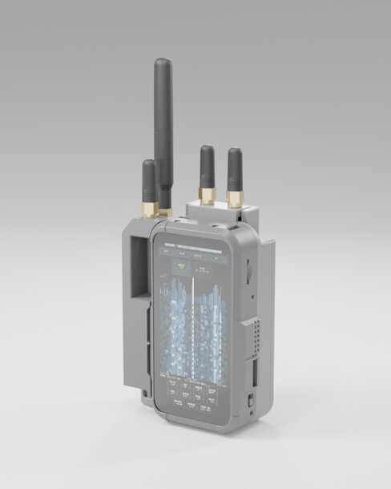
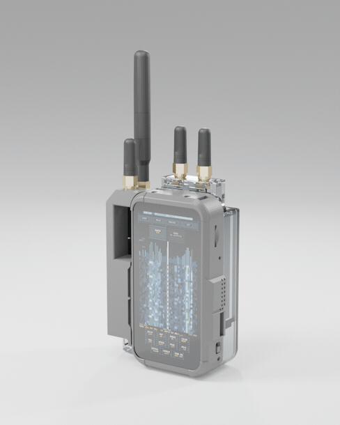

**[Handheld case renders →](https://terminalbay.com/?m=lakeshark-showcase#renders/01)**

</div>

---

<h2 align="center">}<((((-- Meet the LakeShark</h2>

<p align="center">
  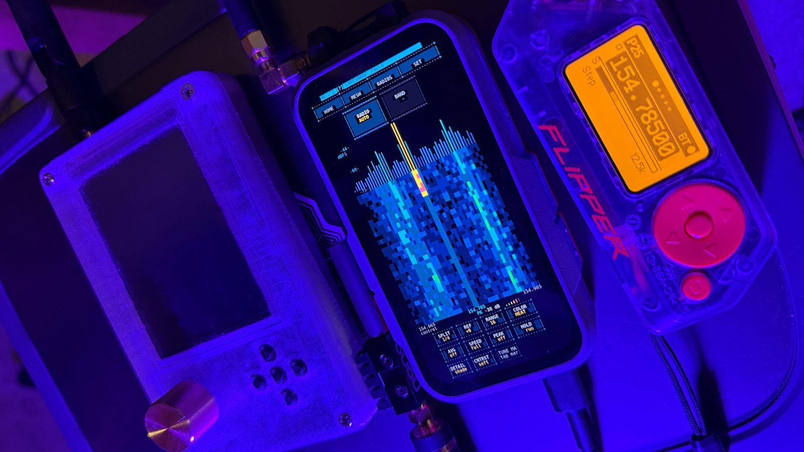
</p>

<div align="center">

**LILYGO T-Display P4 · 4.1" AMOLED · ESP32-P4 · LR2021 or SX1262**

Touchscreen, GPS, motion sensing and an optional detachable MIX-RF keyboard.

</div>

<p align="center">
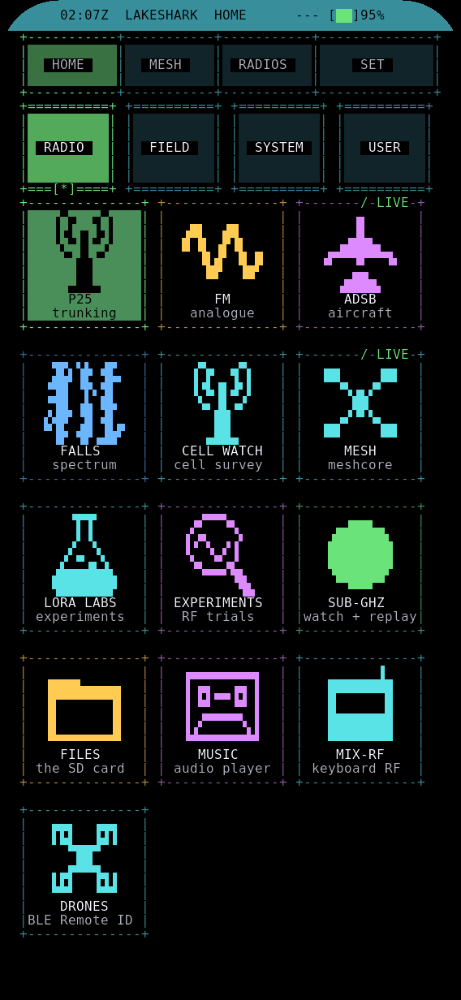
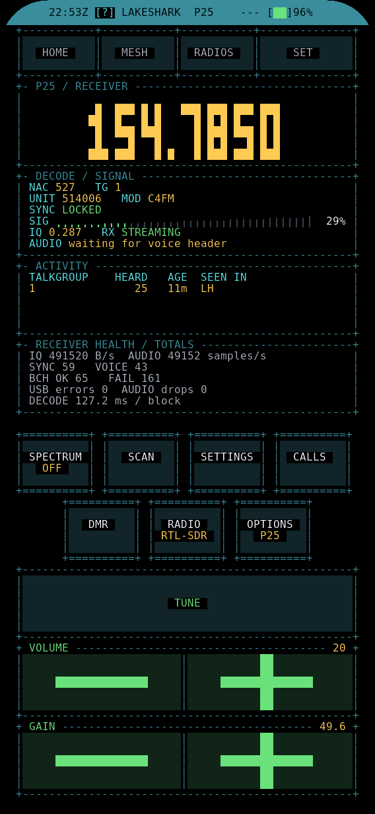
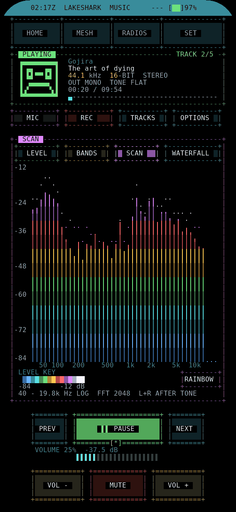
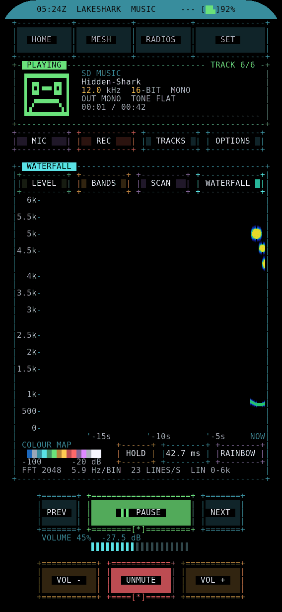
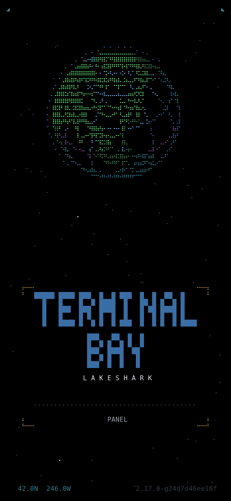
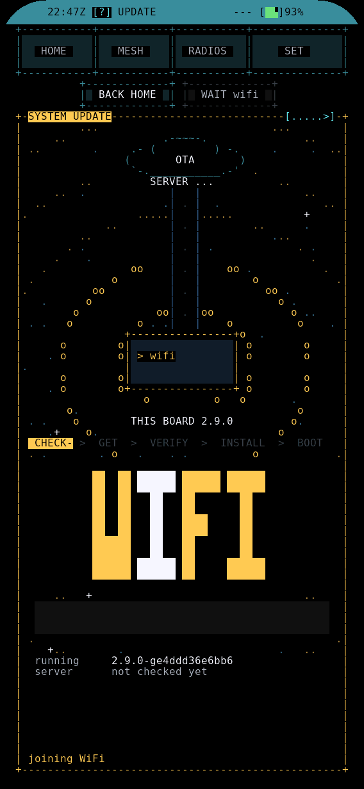
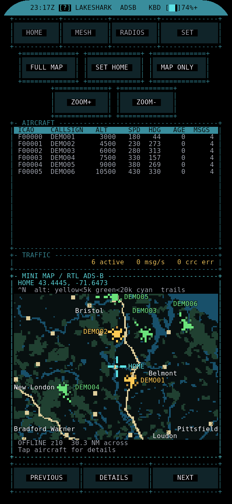
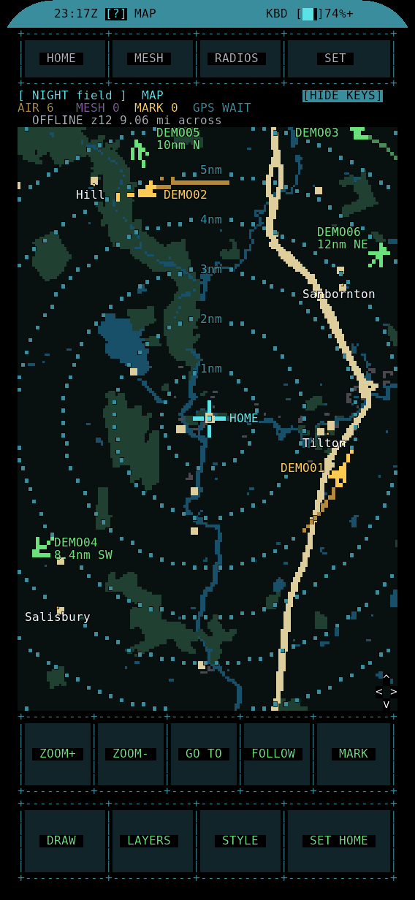
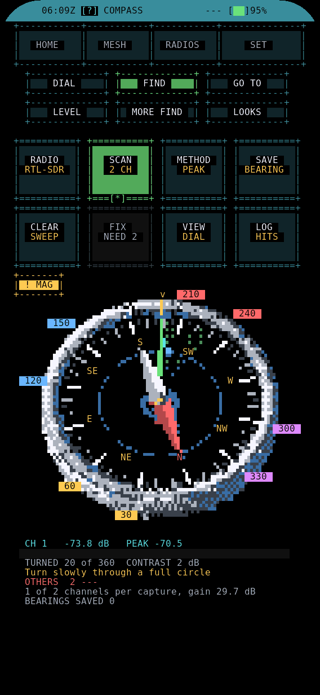
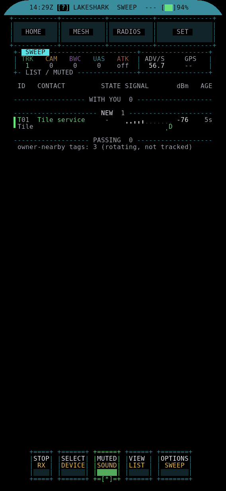
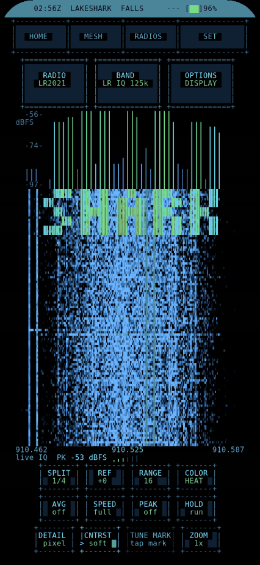
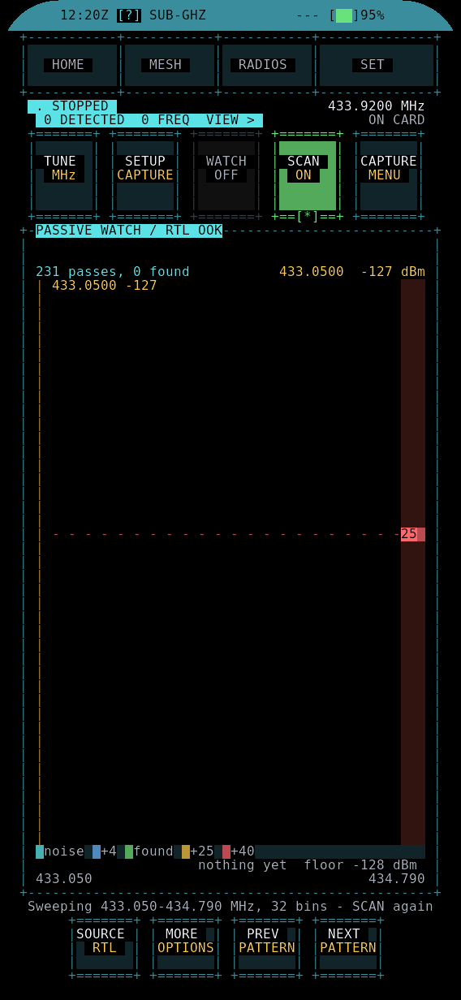
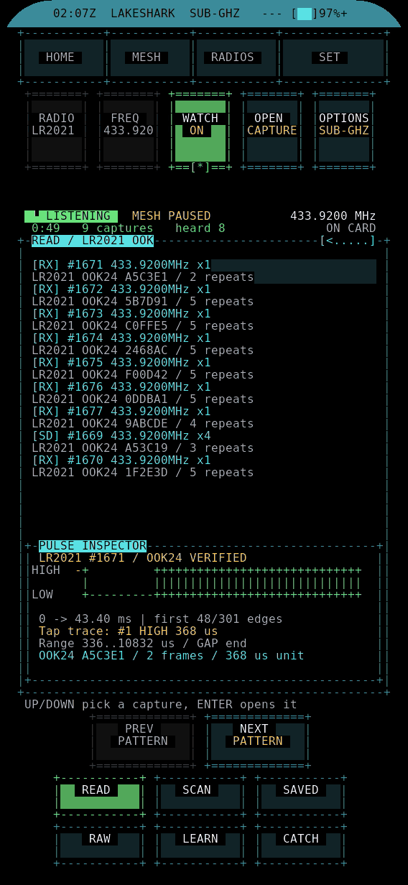
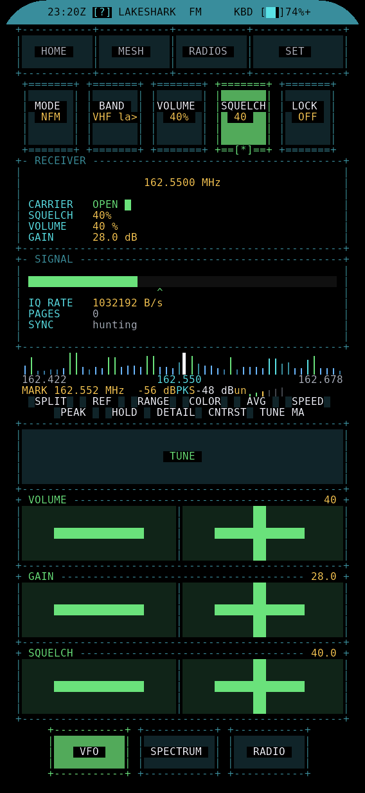
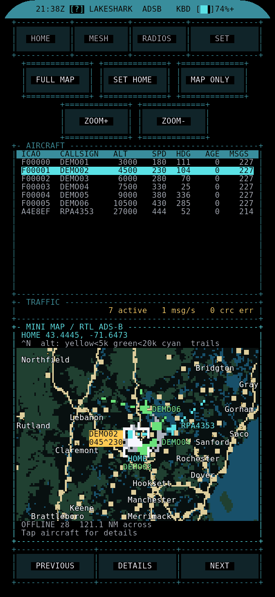
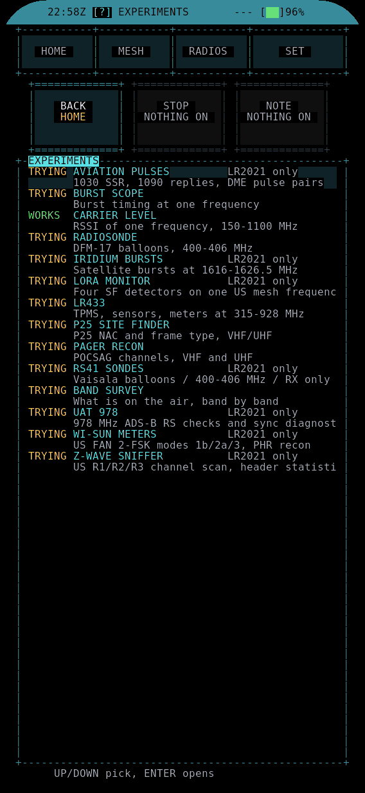
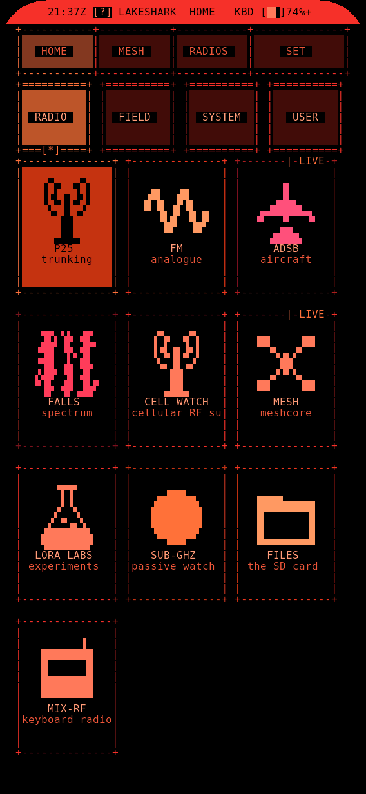
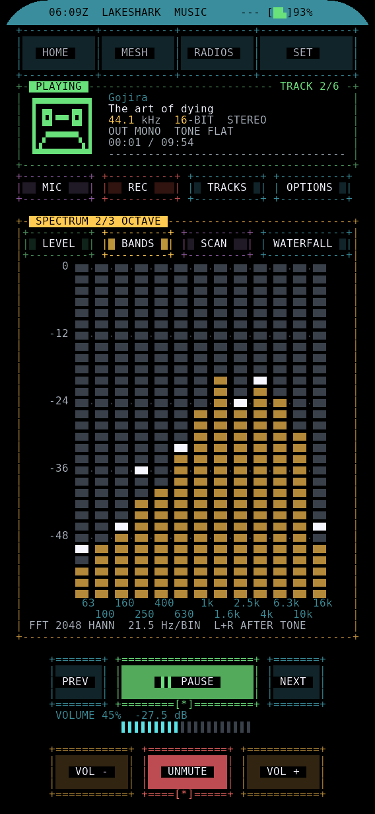
</p>

## Applications

### Radio and signal decoding

| App | Features |
| --- | --- |
| **P25** | Phase I trunking and conventional voice, channel lists, GPS sites that follow you, TUNE and seek, DMR activity and call archive. Phase II `[EXPERIMENTAL]` |
| **FM** | FM/AM, one-tap scanning, TUNE and seek, POCSAG, FLEX, ACARS, CTCSS/DCS, APRS, AIS and SAME alerts |
| **ADS-B** | 1090 MHz aircraft tracking, traffic history, mini map and spoken notifications |
| **FALLS** | Live P25, FM and LoRa waterfalls with touch-to-tune |
| **CELL WATCH** | Cellular band survey |

### Mesh and LoRa

| App | Features |
| --- | --- |
| **MESH** | MeshCore messaging, node discovery, notifications, spoken messages, routes and telemetry |
| **LORA LABS** | Direct radio controls, packet view, signal history and compass |

### Sub-GHz and RF tools

| App | Features |
| --- | --- |
| **SUB-GHZ** | Read, analyzer, saved captures, raw recording and learning. OOK/FSK replay `[EXPERIMENTAL]` |
| **REC** | Signal capture, `.sub` export, playback and waveforms. LR2021 I/Q recording and replay |
| **MIX-RF** | Keyboard CC1101 energy monitor, nRF24 scans and NFC detection |
| **NFC** | MIFARE Classic reads, block maps, key entry and saved dumps |
| **DRONES** | Receive-only warning for ELRS, 900 MHz hoppers, 2.4 GHz links, 5.8 GHz analog FPV and Remote ID |
| **DETECTOR** | Background alerts for Remote ID drones, aircraft emergencies and SWEEP categories, with your own rules on the SD card |
| **EXPERIMENTS** | LR2021 experiments: RS41 sondes and LR433 sensors `[EXPERIMENTAL]` |

### Mapping and navigation

| App | Features |
| --- | --- |
| **MAP** | Offline maps in full colour with shaded relief, or in text. Aircraft, Mesh nodes, ships, APRS, routes and markers shared over MeshCore |
| **TILES** | Download map regions, or a whole state from a globe |
| **COMPASS** | Tilt-compensated heading, transmitter finding, RADAR and HEAT views `[EXPERIMENTAL]` |
| **GPS** | Position, navigation and GPX tracks |
| **NOTES** | Markdown notes with checklists and live GPS, heading and radio data |

### Media and system

| App | Features |
| --- | --- |
| **MUSIC** | WAV playback, VFD meters, octave bands, spectrum, a pixel waterfall that shows what is hidden in a recording, and mic recording |
| **FILES** | Browse and sort the SD card, preview `.sub` files and play recordings |
| **UPDATE** | One-tap signed updates over Wi-Fi, and C6 firmware from the SD card |
| **SET** | Brightness, themes, fonts, sounds, speech, Ukrainian, hotspot password and daylight mode |
| **RADIOS** | Radio power, antenna and Wi-Fi/Bluetooth startup |
| **LINK** | Wi-Fi/Bluetooth scanning and SURVEY war driving to WiGLE CSV. Needs [ESP-Hosted C6 firmware](c6_firmware/README.md) |
| **DIAG** | Memory, radios, sensors and logs |
| **TERMINAL** | On-device console |

The [web tools](https://terminalbay.com/?m=lakeshark) make P25 profiles, GPS scan lists, channel memories and map tiles. [Replay and aircraft details](docs/REPLAY_AND_AIRCRAFT.md)

### Remote terminal

The whole interface in a terminal on your computer, with keys and mouse clicks.

- **USB:** `python host/lsterm/lsterm.py` (or add the port, `COM5`).
- **Wi-Fi:** `term net on` on the board prints a password, then `python host/lsterm/lsterm.py tcp://<board-ip>` or `telnet <board-ip> 2323`.

Its side panel has snapshots, recordings, screen off, volume, a console and the SD card. [lsterm guide](host/lsterm/README.md)

---

## More ways to run LakeShark

### Headless ESP32-P4

The **Waveshare ESP32-P4-NANO** and **ESP32-P4-WIFI6** run the same receivers with no display, controlled from a serial console, a Flipper Zero or the [remote terminal](#remote-terminal). On the NANO the terminal is the full interface (`panel term 160x40` sets its size).

### Flipper Zero control head

<div align="center">

**Your Flipper becomes the display and controls. LakeShark handles the radio.**

The [LakeShark-Flipper app](https://github.com/SAMS0N1TE/LakeShark-Flipper) connects over Bluetooth, with no pairing code, or GPIO.

| | |
| :---: | :---: |
|  |  |
| Offline aircraft map | ADS-B traffic |
|  |  |
| App launcher | P25 radio |

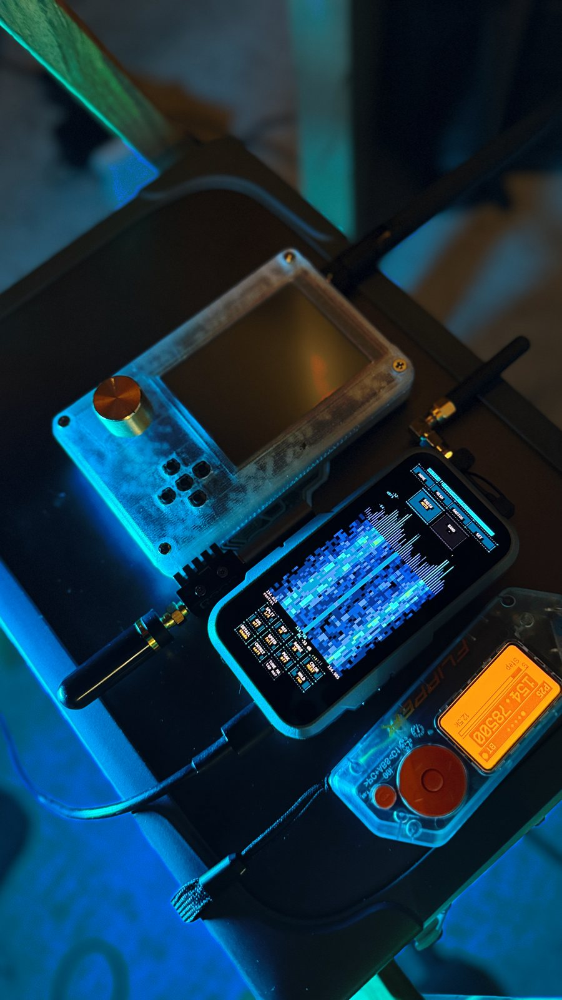

**[Flipper setup guide →](https://terminalbay.com/?m=wiki#flipper/Home)**

</div>

### Waveshare touch boards

The Touch-LCD-4.3 (480 × 800), Touch-LCD-4B and Smart 86 Box (720 × 720) builds end with 2.16.4. [Install LCD-4.3 firmware](https://terminalbay.com/?m=lakeshark&board=lcd43) &nbsp;•&nbsp; [Quick start](https://terminalbay.com/?m=wiki#lcd43/LCD43_QUICKSTART)

---

## Experimental features

| Feature | Status |
| --- | --- |
| **P25 Phase II** | Grant following, bench-tested with public recordings; live RF unverified. Off after restart. [Details](docs/P25_PHASE2.md) |
| **HackRF One** | FM, POCSAG, ACARS, P25, recording and ADS-B. Pagers verified; live P25 unconfirmed. [Status](docs/HACKRF_BRINGUP.md) |
| **LR2021 I/Q TX** | Short custom waveforms, including P25 test tones and temperature packets. [Research](docs/LR2021_IQ_TX.md) |
| **LR2021 I/Q replay** | 433 MHz captures. OOK replay verified; FSK not yet verified over the air |
| **C6 firmware update** | From the SD card. Recovery still needs the UART header. [Details](c6_firmware/README.md) |
| **Wi-Fi terminal** | TCP port 2323 with a password. USB is the tested link |
| **LoRa bearing plots** | RSSI by compass heading. Not validated direction finding |
| **Location scanning** | Mixed P25/FM lists, GPS filtering and CSV/JSON import. [Details](docs/LOCATION_SCAN.md) |
| **RadioReference adapter** | Needs an approved API key and Premium account. Live sign-in unverified |

---

## Build from source

ESP-IDF **5.5.4** with the six fixes in `bench/patches/`, applied once:

```powershell
pwsh -File bench/patch-idf.ps1 -IdfPath /path/to/esp-idf -Apply
```

One build directory per target:

```sh
# T-Display P4 AMOLED (568 × 1232, 16 MB)
idf.py -B build_tdp4 -D SDKCONFIG=build_tdp4/sdkconfig -D SDKCONFIG_DEFAULTS="sdkconfig.defaults;boards/t_display_p4.defaults" build

# T-Display P4 TFT (HI8561, 540 × 1168)
idf.py -B build_tdp4_tft -D SDKCONFIG=build_tdp4_tft/sdkconfig -D SDKCONFIG_DEFAULTS="sdkconfig.defaults;boards/t_display_p4.defaults;boards/t_display_p4_tft.defaults" build

# LakeShark LR: LR2021 only, no USB host, RTL-SDR, HackRF or SX1262
idf.py -B build_tdp4_lr -D SDKCONFIG=build_tdp4_lr/sdkconfig -D SDKCONFIG_DEFAULTS="sdkconfig.defaults;boards/t_display_p4.defaults;boards/t_display_p4_lr2021.defaults" build

# Waveshare P4 headless
idf.py -B build_nano -D SDKCONFIG=build_nano/sdkconfig -D SDKCONFIG_DEFAULTS="sdkconfig.defaults;boards/nano_headless_ble.defaults" build
```

`boards/` holds the target defaults and partition layouts; `main/idf_component.yml` pins dependencies. Host checks: `pwsh -File bench/verify.ps1 -Level host`

---

## Credits and open-source projects

| Project | Contribution |
| --- | --- |
| [rtl-sdr / librtlsdr](https://osmocom.org/projects/rtl-sdr) | Osmocom. RTL-SDR driver foundation. GPL-2.0+ |
| [xtrsdr](https://github.com/XTR1984/xtrsdr) | XTR1984. ESP32-optimized librtlsdr implementation, essential to this project |
| [OP25](https://github.com/boatbod/op25) | Pavel Yazev's fixed-point `imbe_vocoder`. Experimental Phase II work by Max H. Parke, Graham J. Norbury and contributors. GPL-3.0+ |
| [libmodes](https://github.com/watson/libmodes) / [dump1090](https://github.com/antirez/dump1090) | Thomas Watson and Salvatore Sanfilippo. Mode S decoder lineage. BSD-2-Clause |
| [ADS-B Scope](https://github.com/jstockdale/T-Display-P4/tree/adsb) | John Stockdale and Off by One, Inc. Original implementation and single-frame CPR reference |
| [DSD](https://github.com/szechyjs/dsd) / [dsd-fme](https://github.com/lwvmobile/dsd-fme) | szechyjs and lwvmobile. P25 symbol and framing foundations. ISC-style notices |
| [mbelib](https://github.com/szechyjs/mbelib) | szechyjs. Fallback vocoder. ISC |
| [ESP-IDF](https://github.com/espressif/esp-idf) | Espressif. Embedded development framework |
| [LILYGO device drivers](https://github.com/Xinyuan-LilyGO/lilygo_device_driver) | T-Display P4 and MIX-RF hardware drivers, wiring and power examples |
| [MeshCore](https://github.com/meshcore-dev/MeshCore) | Scott Powell / Ripple Radios and contributors. Mesh radio stack |
| [CartoTUI](https://github.com/SAMS0N1TE/CartoTUI) / [ZeroMesh](https://github.com/SAMS0N1TE/ZeroMesh) | libcarto rendering and embedded PMTiles reader |
| [PMTiles](https://github.com/protomaps/PMTiles) | Protomaps. Seekable, single-file offline map storage |
| [OpenStreetMap](https://www.openstreetmap.org/copyright) | Open map data. ODbL |
| [Flipper Zero firmware](https://github.com/flipperdevices/flipperzero-firmware) | Flipper Devices and contributors. Control-head platform and Crypto1 helpers |
| [DejaVu](https://dejavu-fonts.github.io/) | Interface fonts |
| [Waveshare](https://github.com/waveshareteam) | ESP32-P4 board support and hardware examples |

The field-map design drew on [Cardputer offgrid map](https://github.com/yuiseki/m5-cardputer-offgrid-tiny-map) by yuiseki and [HikePod](https://github.com/nongxl/HikePod) by nongxl. No source code was copied from either.

<div align="center">

---

### Open source. Built for experimentation.

**[Install](https://terminalbay.com/?m=lakeshark)** &nbsp;•&nbsp;
**[Documentation](https://terminalbay.com/?m=wiki)** &nbsp;•&nbsp;
**[Releases](https://github.com/SAMS0N1TE/LakeShark/releases)** &nbsp;•&nbsp;
**[Roadmap](https://terminalbay.com/?m=lakeshark-roadmap)** &nbsp;•&nbsp;
**[Suggest a feature](https://terminalbay.com/?m=lakeshark-roadmap#ask)**

LakeShark is licensed under [GPL-3.0](LICENSE). Third-party components retain their respective licenses. [Third-party license inventory](docs/THIRD_PARTY_NOTICES.md)

<sub>Radio reception and transmission are subject to local laws and regulations.</sub>

</div>
