<p align="center">
  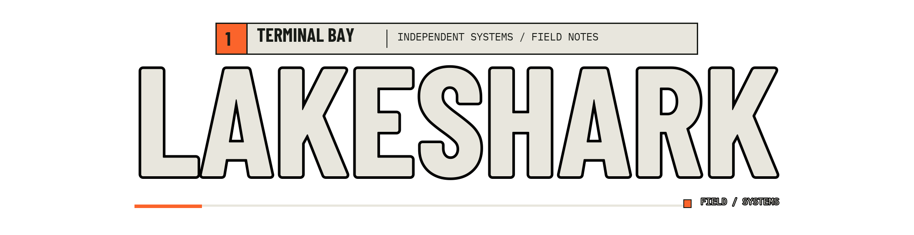
</p>

<h3 align="center">A handheld SDR powered by a LoRa chip, RTL-SDR, and HackRF</h3>

<p align="center">
  <strong>P25 Digital Voice · FM Radio · ADS-B Aircraft · Pagers · MeshCore · RF Tools</strong>
</p>

<p align="center">
  Turn the <a href="https://lilygo.cc/en-us/products/t-display-p4">LILYGO T-Display P4</a>
  into an open-source handheld radio multitool.
</p>

<p align="center">
  <strong><a href="https://terminalbay.com/?m=lakeshark">Install LakeShark</a></strong>
  &nbsp;·&nbsp;
  <strong><a href="https://terminalbay.com/?m=lakeshark-showcase">See it in action</a></strong>
  &nbsp;·&nbsp;
  <strong><a href="https://terminalbay.com/?m=wiki">Documentation</a></strong>
</p>

<p align="center">
  
</p>

<h2 align="center">A LoRa chip. A whole new radio.</h2>

<p align="center"><strong>The onboard LR2021 receives P25 voice, aircraft and pagers. No external SDR required.</strong></p>

<table align="center">
  <thead>
    <tr>
      <th align="center">DIGITAL VOICE</th>
      <th align="center">AIRCRAFT</th>
      <th align="center">SIGNALS</th>
    </tr>
  </thead>
  <tbody>
    <tr>
      <td align="center"><strong>P25 Phase I</strong></td>
      <td align="center"><strong>1090 MHz ADS-B</strong></td>
      <td align="center"><strong>FM + POCSAG</strong></td>
    </tr>
    <tr>
      <td align="center">Hear digital radio</td>
      <td align="center">Track aircraft live</td>
      <td align="center">Listen, decode and visualize</td>
    </tr>
  </tbody>
</table>

<p align="center"><strong>Raw I/Q capture · Live waterfalls · Software demodulation · Experimental I/Q transmission</strong></p>

<p align="center"><strong><a href="https://github.com/SAMS0N1TE/lr2021-sdr">Explore LR2021-SDR →</a></strong></p>

<h2 align="center">LakeShark Desktop and Studio</h2>

<p align="center"><strong>Run every app in windows on your PC. Write your own in minutes.</strong><br>New in the 2.20.0-rc1 pre-release.</p>

<h3 align="center"><a href="https://github.com/SAMS0N1TE/LakeShark/blob/release/2.20.0-rc1/app-sdk/README.md#your-first-app-in-5-minutes">Make your first app →</a></h3>

<p align="center">
  <a href="https://www.waveshare.com/esp32-p4-nano-wifi6-db.htm">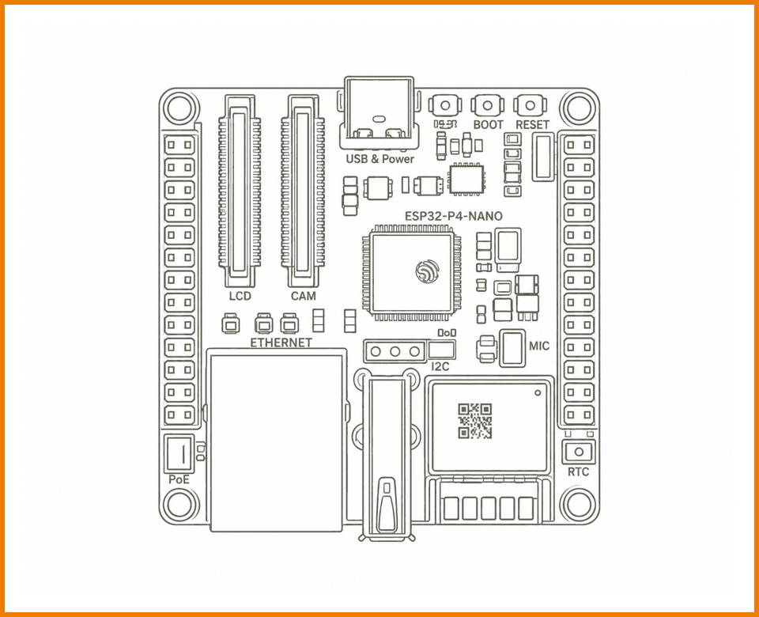</a>
</p>

<p align="center"><strong>Real hardware, not an emulator (but also an emulator too).</strong> The apps run on a
<a href="https://www.waveshare.com/esp32-p4-nano-wifi6-db.htm">Waveshare ESP32-P4-NANO</a> with its radios and SD card. Your PC is its
screen, mouse and keyboard over one USB cable.</p>

<p align="center">
  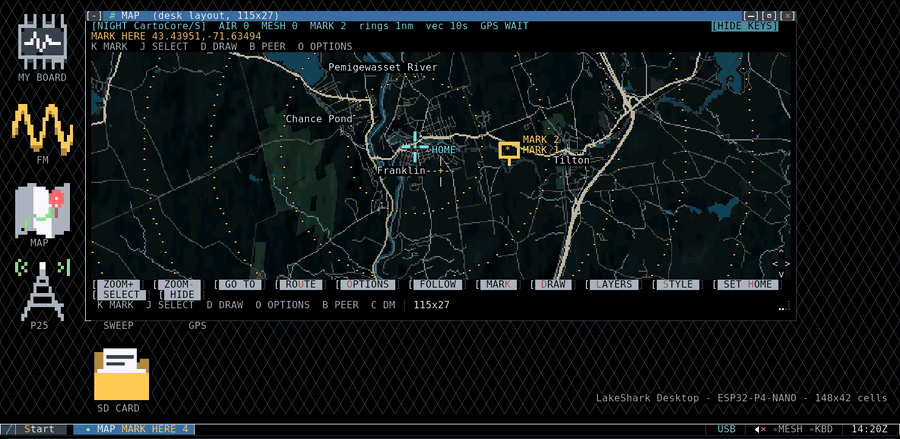
  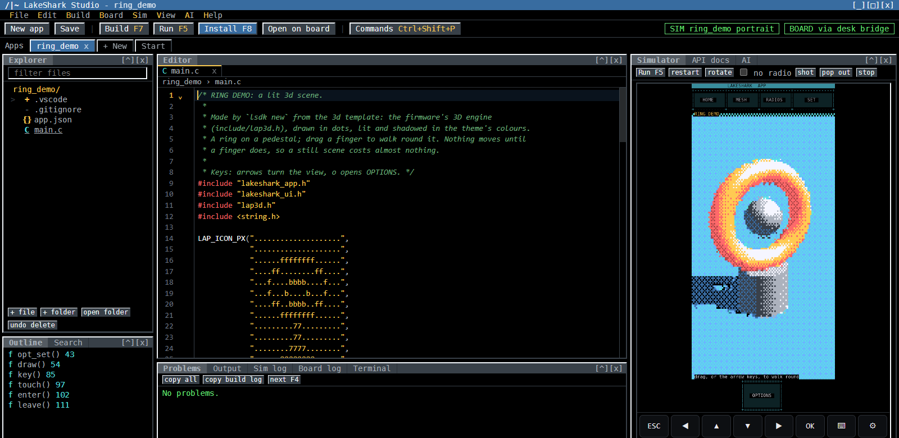
</p>
<p align="center">
  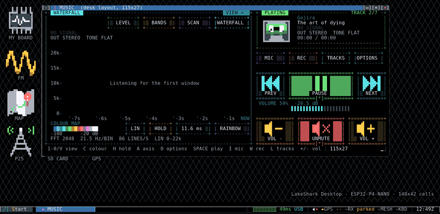
  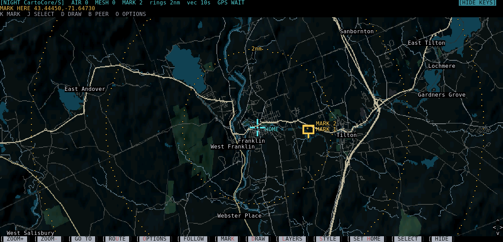
</p>

<table align="center">
  <thead>
    <tr>
      <th align="center">DESKTOP</th>
      <th align="center">STUDIO</th>
      <th align="center">SIMULATOR</th>
    </tr>
  </thead>
  <tbody>
    <tr>
      <td align="center"><strong>Every app, windowed</strong></td>
      <td align="center"><strong>Write, build, install</strong></td>
      <td align="center"><strong>The real UI on your PC</strong></td>
    </tr>
    <tr>
      <td align="center">On a <a href="https://www.waveshare.com/esp32-p4-nano-wifi6-db.htm">Waveshare ESP32-P4-NANO</a>, over USB</td>
      <td align="center">From one window, F5 to F8</td>
      <td align="center">Click, type, tilt and swipe</td>
    </tr>
  </tbody>
</table>

- **LakeShark Desktop:** the board draws every window and runs every receiver; the PC only shows the picture and sends your input. Taskbar, Start menu, wallpapers and themes, all drawn in characters. Drag windows, pan MAP with the mouse, type with a real keyboard. **Focused mode** (Ctrl+F11) gives one app or game the whole screen at twice the frame rate.
- **LakeShark Studio:** an editor with outline, search and a problems list. **Build** (F7), **Run** in the simulator (F5), **Install** on the board (F8) and watch the board log, all in one window. An **AI panel** and an MCP server let the AI you already use read the API and build with you.
- **Simulator:** the same TUI the board runs. Tilt and shake it, swipe it, feed it radio traffic (APRS, mesh, pages), set the clock to night or noon, rotate it, and take shots.
- **`lsdk`:** the same from any terminal. `lsdk new` starts from a template (blank, radio, dots, 3d, service), `lsdk sim` runs it, `lsdk install --open` puts it on the board.
- **Share it:** apps are one `.lap` file on the SD card, and the [app store](https://terminalbay.com/?m=lakeshark-apps) installs them in one click.

<p align="center">
  <a href="https://github.com/SAMS0N1TE/LakeShark/releases/tag/v2.20.0-rc1">Try 2.20.0-rc1</a>
  &nbsp;·&nbsp;
  <a href="https://github.com/SAMS0N1TE/LakeShark/blob/release/2.20.0-rc1/app-sdk/README.md#your-first-app-in-5-minutes">Make your first app</a>
</p>

<h2 align="center">New in v2.19</h2>

<p align="center">Folders on HOME · DIGI: FT8, FT4 and WSPR · HF on the RTL-SDR and HackRF · METERS · P25 on the LR2021 with RAM to spare</p>

<p align="center">
  <a href="https://github.com/SAMS0N1TE/LakeShark/releases/tag/v2.19.0">Release notes</a>
  &nbsp;·&nbsp;
  <a href="https://github.com/SAMS0N1TE/LakeShark/releases">All releases</a>
</p>

<h2 align="center">New in v2.18</h2>

<p align="center">Apps from the SD card · <a href="https://terminalbay.com/?m=lakeshark-apps">App store with one-click installs</a> · Live screen and files in the browser · Faster MAP picture</p>

<p align="center">
  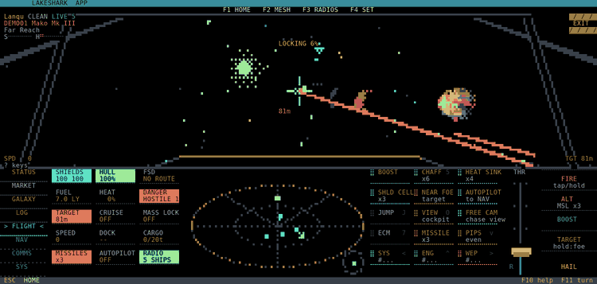
  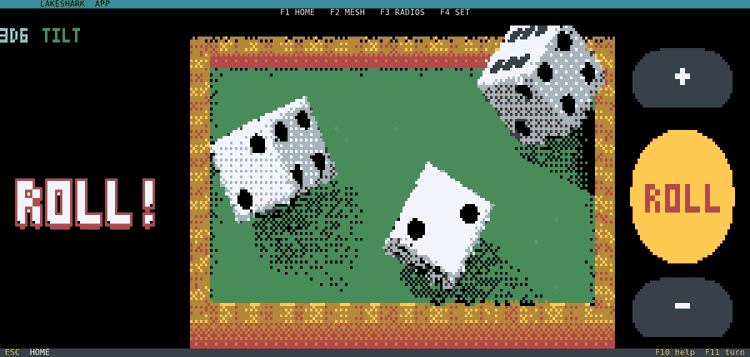
</p>

<p align="center">
  <a href="https://github.com/SAMS0N1TE/LakeShark/releases/tag/v2.18.0">Release notes</a>
  &nbsp;·&nbsp;
  <a href="https://github.com/SAMS0N1TE/LakeShark/releases">All releases</a>
</p>

<h2 align="center">Hardware</h2>

<table align="center">
  <thead>
    <tr>
      <th>Hardware</th>
      <th>Capabilities</th>
    </tr>
  </thead>
  <tbody>
    <tr>
      <td><strong>T-Display P4 + LR2021</strong></td>
      <td>Onboard P25 voice, FM, ADS-B, pagers, MeshCore and LoRa tools</td>
    </tr>
    <tr>
      <td><strong>T-Display P4 + SX1262</strong></td>
      <td>MeshCore, LoRa and POCSAG. Add an RTL-SDR for FM, P25 and ADS-B</td>
    </tr>
    <tr>
      <td><strong>RTL-SDR Blog V3/V4</strong></td>
      <td>External SDR reception, P25 Phase I trunking and sub-GHz captures</td>
    </tr>
    <tr>
      <td><strong>MIX-RF keyboard</strong></td>
      <td>Optional physical controls, CC1101, nRF24 and NFC</td>
    </tr>
  </tbody>
</table>

<p align="center"><strong>Install</strong> from Chrome or Edge with the <a href="https://terminalbay.com/?m=lakeshark">browser installer</a>. Already installed? The <strong>UPDATE</strong> app updates over Wi-Fi in one tap.</p>

<blockquote><p align="center"><strong>Power:</strong> power the P4 from its own USB-C input, never from the keyboard's 5V USB output. That causes repeated power cycling.</p></blockquote>

<h2 align="center">LakeShark Pager (coming soon)</h2>

<table align="center">
  <tr><th colspan="2">MK1</th></tr>
  <tr>
    <td colspan="2" align="center">
      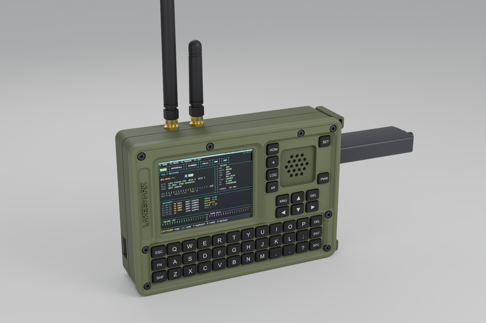
    </td>
  </tr>
  <tr>
    <th>MK2 · Front</th>
    <th>MK2 · Angled view</th>
  </tr>
  <tr>
    <td align="center">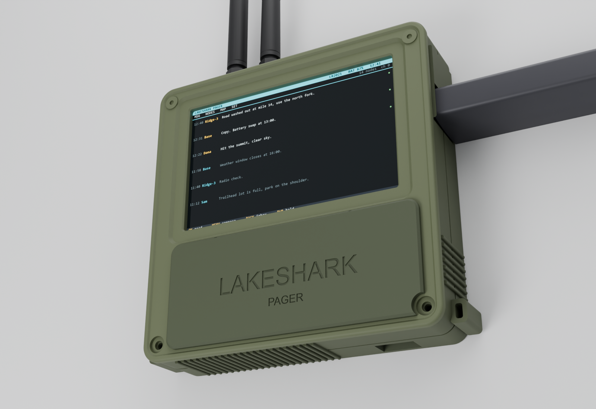</td>
    <td align="center">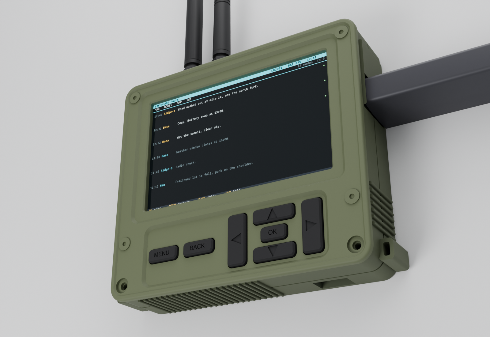</td>
  </tr>
</table>

<p align="center">
  
</p>

<h2 align="center">Meet the LakeShark</h2>

<p align="center">
  
</p>

<p align="center">
  <strong>LILYGO T-Display P4 · 4.1&quot; AMOLED · ESP32-P4 · LR2021 or SX1262</strong><br>
  Touchscreen, GPS, motion sensing, and an optional detachable MIX-RF keyboard.
</p>

<p align="center">
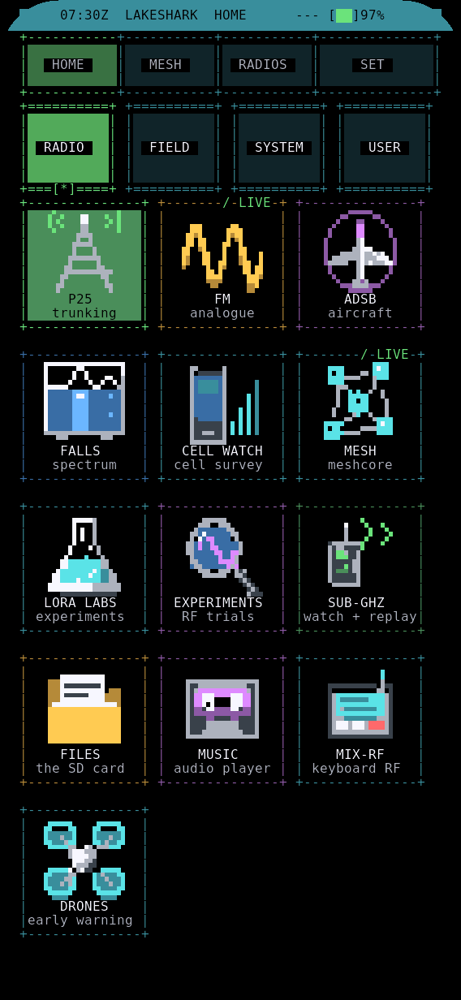


</p>

<details>
<summary><strong>More screenshots</strong></summary>
<br>

<p align="center">
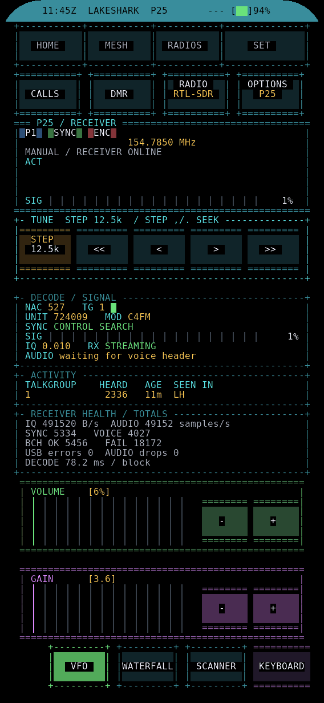
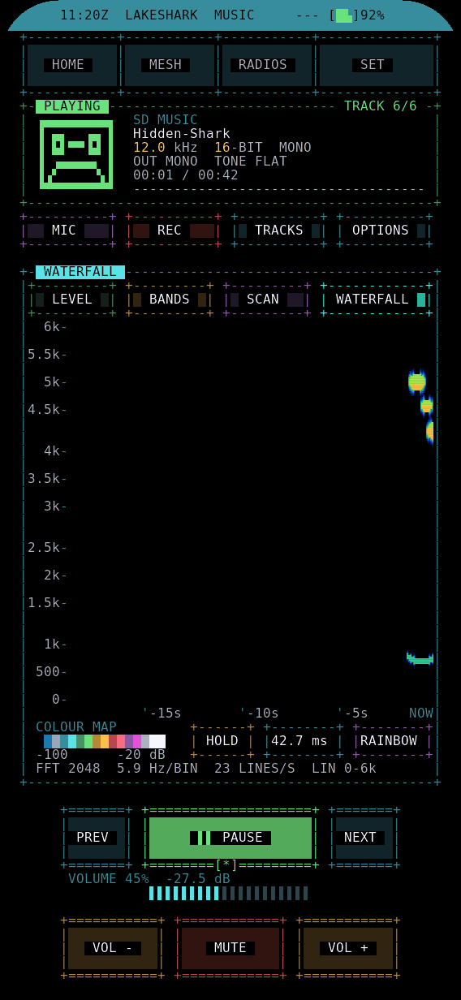


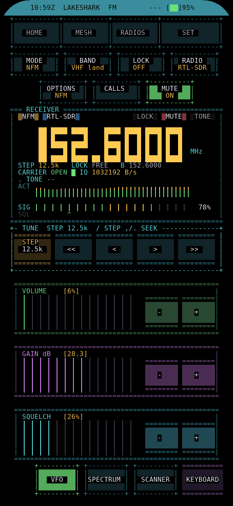


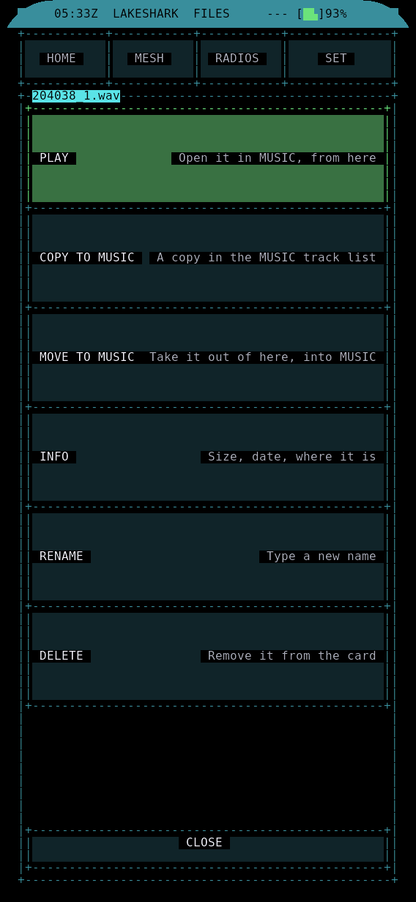
</p>

</details>

## Applications

P25 voice and trunking, FM with pagers and data, ADS-B, waterfalls, MeshCore, Sub-GHz capture and replay, FT8, offline maps, a compass, GPS, music and more: about thirty apps, each with its own guide.

<p align="center"><strong><a href="https://terminalbay.com/?m=wiki#tdp4/APPS">Browse every app in the wiki →</a></strong></p>

The [web tools](https://terminalbay.com/?m=lakeshark) make P25 profiles, GPS scan lists, channel memories and map tiles. [Replay and aircraft details](docs/REPLAY_AND_AIRCRAFT.md)

### Remote terminal

The whole interface in a terminal on your computer, with keys and mouse clicks.

- **USB:** `python host/lsterm/lsterm.py` (or add the port, `COM5`).
- **Wi-Fi:** `term net on` on the board prints a password, then `python host/lsterm/lsterm.py tcp://<board-ip>` or `telnet <board-ip> 2323`.
- **SSH (ESP32-P4-NANO builds):** `term ssh on` (or LINK > REMOTE), then `ssh <board-ip>`. Encrypted; the same password, or a key the board learns once (LEARN on the REMOTE page, then one password login) or reads from `lakeshark/authorized_keys` on the SD card.

Its side panel has snapshots, recordings, screen off, volume, a console and the SD card. [lsterm guide](host/lsterm/README.md)

### Apps

Games and tools that run from the SD card, each with its own tile under USER on HOME.

- **Store:** open the [LakeShark hub](https://terminalbay.com/?m=lakeshark-hub) in Chrome or Edge, connect the board with USB and press INSTALL.
- **By hand:** copy a `.lap` file into `/apps` on the SD card.
- **Your own:** write one in C with the [app SDK](app-sdk/README.md). DICE, SNAKE, PINBALL and MESHLING are the examples.

The hub also shows the board's screen live, browses and copies files on the SD card, and runs the console, all in the browser.

<p align="center">
  
</p>

## More ways to run LakeShark

### Headless ESP32-P4

The **Waveshare ESP32-P4-NANO** and **ESP32-P4-WIFI6** run the same receivers with no display, controlled from a serial console, a Flipper Zero or the [remote terminal](#remote-terminal). On the NANO the terminal is the full interface (`panel term 160x40` sets its size).

### Flipper Zero control head

<p align="center">
  <strong>Your Flipper becomes the display and controls. LakeShark handles the radio.</strong>
</p>

The [LakeShark-Flipper app](https://github.com/SAMS0N1TE/LakeShark-Flipper) connects over Bluetooth, with no pairing code, or GPIO.

<table align="center">
  <thead>
    <tr>
      <th align="center">Offline aircraft map</th>
      <th align="center">ADS-B traffic</th>
    </tr>
  </thead>
  <tbody>
    <tr>
      <td align="center"></td>
      <td align="center"></td>
    </tr>
    <tr>
      <td align="center">App launcher</td>
      <td align="center">P25 radio</td>
    </tr>
    <tr>
      <td align="center"></td>
      <td align="center"></td>
    </tr>
  </tbody>
</table>

<p align="center">
  
</p>

<p align="center">
  <strong><a href="https://terminalbay.com/?m=wiki#flipper/Home">Flipper setup guide →</a></strong>
</p>

### Waveshare touch boards

The Touch-LCD-4.3 (480 × 800), Touch-LCD-4B and Smart 86 Box (720 × 720) builds end with 2.16.4. [Install LCD-4.3 firmware](https://terminalbay.com/?m=lakeshark&board=lcd43) &nbsp;•&nbsp; [Quick start](https://terminalbay.com/?m=wiki#lcd43/LCD43_QUICKSTART)

<p align="center">
  
</p>

## Experimental features

<table align="center">
  <thead>
    <tr>
      <th>Feature</th>
      <th>Status</th>
    </tr>
  </thead>
  <tbody>
    <tr>
      <td><strong>P25 Phase II</strong></td>
      <td>Grant following, bench-tested with public recordings; live RF unverified. Off after restart. <a href="docs/P25_PHASE2.md">Details</a></td>
    </tr>
    <tr>
      <td><strong>HackRF One</strong></td>
      <td>FM, POCSAG, ACARS, P25, recording and ADS-B. Pagers verified; live P25 unconfirmed. <a href="docs/HACKRF_BRINGUP.md">Status</a></td>
    </tr>
    <tr>
      <td><strong>LR2021 I/Q TX</strong></td>
      <td>Short custom waveforms, including P25 test tones and temperature packets. <a href="docs/LR2021_IQ_TX.md">Research</a></td>
    </tr>
    <tr>
      <td><strong>LR2021 I/Q replay</strong></td>
      <td>433 MHz captures. OOK replay verified; FSK not yet verified over the air</td>
    </tr>
    <tr>
      <td><strong>C6 firmware update</strong></td>
      <td>From the SD card. Recovery still needs the UART header. <a href="c6_firmware/README.md">Details</a></td>
    </tr>
    <tr>
      <td><strong>Wi-Fi terminal</strong></td>
      <td>Telnet on 2323 with a password. SSH on 22 on ESP32-P4-NANO builds. USB is the tested link</td>
    </tr>
    <tr>
      <td><strong>LoRa bearing plots</strong></td>
      <td>RSSI by compass heading. Not validated direction finding</td>
    </tr>
    <tr>
      <td><strong>Location scanning</strong></td>
      <td>Mixed P25/FM lists, GPS filtering and CSV/JSON import. <a href="docs/LOCATION_SCAN.md">Details</a></td>
    </tr>
    <tr>
      <td><strong>RadioReference adapter</strong></td>
      <td>Needs an approved API key and Premium account. Live sign-in unverified</td>
    </tr>
  </tbody>
</table>

<p align="center">
  
</p>

## Build from source

ESP-IDF **5.5.4** with the six fixes in `bench/patches/`, applied once:

```powershell
pwsh -File bench/patch-idf.ps1 -IdfPath /path/to/esp-idf -Apply
```

One build directory per target:

```sh
# T-Display P4 AMOLED (568 × 1232, 16 MB)
idf.py -B build_tdp4 -D SDKCONFIG=build_tdp4/sdkconfig -D SDKCONFIG_DEFAULTS="sdkconfig.defaults;boards/t_display_p4.defaults" build

# T-Display P4 TFT (HI8561, 540 × 1168)
idf.py -B build_tdp4_tft -D SDKCONFIG=build_tdp4_tft/sdkconfig -D SDKCONFIG_DEFAULTS="sdkconfig.defaults;boards/t_display_p4.defaults;boards/t_display_p4_tft.defaults" build

# LakeShark LR: LR2021 only, no USB host, RTL-SDR, HackRF or SX1262
idf.py -B build_tdp4_lr -D SDKCONFIG=build_tdp4_lr/sdkconfig -D SDKCONFIG_DEFAULTS="sdkconfig.defaults;boards/t_display_p4.defaults;boards/t_display_p4_lr2021.defaults" build

# Waveshare P4 headless
idf.py -B build_nano -D SDKCONFIG=build_nano/sdkconfig -D SDKCONFIG_DEFAULTS="sdkconfig.defaults;boards/nano_headless_ble.defaults" build
```

`boards/` holds the target defaults and partition layouts; `main/idf_component.yml` pins dependencies. Host checks: `pwsh -File bench/verify.ps1 -Level host`

<p align="center">
  
</p>

## Credits and open-source projects

<table align="center">
  <thead>
    <tr>
      <th>Project</th>
      <th>Contribution</th>
    </tr>
  </thead>
  <tbody>
    <tr>
      <td><a href="https://osmocom.org/projects/rtl-sdr">rtl-sdr / librtlsdr</a></td>
      <td>Osmocom. RTL-SDR driver foundation. GPL-2.0+</td>
    </tr>
    <tr>
      <td><a href="https://github.com/XTR1984/xtrsdr">xtrsdr</a></td>
      <td>XTR1984. ESP32-optimized librtlsdr implementation, essential to this project</td>
    </tr>
    <tr>
      <td><a href="https://github.com/boatbod/op25">OP25</a></td>
      <td>Pavel Yazev's fixed-point <code>imbe_vocoder</code>. Experimental Phase II work by Max H. Parke, Graham J. Norbury and contributors. GPL-3.0+</td>
    </tr>
    <tr>
      <td><a href="https://github.com/watson/libmodes">libmodes</a> / <a href="https://github.com/antirez/dump1090">dump1090</a></td>
      <td>Thomas Watson and Salvatore Sanfilippo. Mode S decoder lineage. BSD-2-Clause</td>
    </tr>
    <tr>
      <td><a href="https://github.com/jstockdale/T-Display-P4/tree/adsb">ADS-B Scope</a></td>
      <td>John Stockdale and Off by One, Inc. Original implementation and single-frame CPR reference</td>
    </tr>
    <tr>
      <td><a href="https://github.com/szechyjs/dsd">DSD</a> / <a href="https://github.com/lwvmobile/dsd-fme">dsd-fme</a></td>
      <td>szechyjs and lwvmobile. P25 symbol and framing foundations. ISC-style notices</td>
    </tr>
    <tr>
      <td><a href="https://github.com/szechyjs/mbelib">mbelib</a></td>
      <td>szechyjs. Fallback vocoder. ISC</td>
    </tr>
    <tr>
      <td><a href="https://github.com/espressif/esp-idf">ESP-IDF</a></td>
      <td>Espressif. Embedded development framework</td>
    </tr>
    <tr>
      <td><a href="https://github.com/Xinyuan-LilyGO/lilygo_device_driver">LILYGO device drivers</a></td>
      <td>T-Display P4 and MIX-RF hardware drivers, wiring and power examples</td>
    </tr>
    <tr>
      <td><a href="https://github.com/meshcore-dev/MeshCore">MeshCore</a></td>
      <td>Scott Powell / Ripple Radios and contributors. Mesh radio stack</td>
    </tr>
    <tr>
      <td><a href="https://github.com/SAMS0N1TE/CartoTUI">CartoTUI</a> / <a href="https://github.com/SAMS0N1TE/ZeroMesh">ZeroMesh</a></td>
      <td>libcarto rendering and embedded PMTiles reader</td>
    </tr>
    <tr>
      <td><a href="https://github.com/protomaps/PMTiles">PMTiles</a></td>
      <td>Protomaps. Seekable, single-file offline map storage</td>
    </tr>
    <tr>
      <td><a href="https://www.openstreetmap.org/copyright">OpenStreetMap</a></td>
      <td>Open map data. ODbL</td>
    </tr>
    <tr>
      <td><a href="https://github.com/flipperdevices/flipperzero-firmware">Flipper Zero firmware</a></td>
      <td>Flipper Devices and contributors. Control-head platform and Crypto1 helpers</td>
    </tr>
    <tr>
      <td><a href="https://dejavu-fonts.github.io/">DejaVu</a></td>
      <td>Interface fonts</td>
    </tr>
    <tr>
      <td><a href="https://github.com/waveshareteam">Waveshare</a></td>
      <td>ESP32-P4 board support and hardware examples</td>
    </tr>
  </tbody>
</table>

The field-map design drew on [Cardputer offgrid map](https://github.com/yuiseki/m5-cardputer-offgrid-tiny-map) by yuiseki and [HikePod](https://github.com/nongxl/HikePod) by nongxl. No source code was copied from either.

<p align="center">
  
</p>

<p align="center"><strong>Open source. Built for experimentation.</strong></p>

<p align="center">
  <a href="https://terminalbay.com/?m=lakeshark">Install</a>
  &nbsp;·&nbsp;
  <a href="https://terminalbay.com/?m=wiki">Documentation</a>
  &nbsp;·&nbsp;
  <a href="https://github.com/SAMS0N1TE/LakeShark/releases">Releases</a>
  &nbsp;·&nbsp;
  <a href="https://terminalbay.com/?m=lakeshark-roadmap">Roadmap</a>
  &nbsp;·&nbsp;
  <a href="https://terminalbay.com/?m=lakeshark-roadmap#ask">Suggest a feature</a>
</p>

<p align="center">Contact: <a href="mailto:support@terminalbay.com">support@terminalbay.com</a></p>

<p align="center">
  LakeShark is licensed under <a href="LICENSE">GPL-3.0</a>.
  Third-party components retain their respective licenses.
  <a href="docs/THIRD_PARTY_NOTICES.md">Third-party license inventory</a>.
</p>

<p align="center">
  AI-assisted development and source-derived reimplementations:
  <a href="AI_USE.md">AI use and attribution policy</a>.
</p>

<p align="center"><sub>Radio reception and transmission are subject to local laws and regulations.</sub></p>
