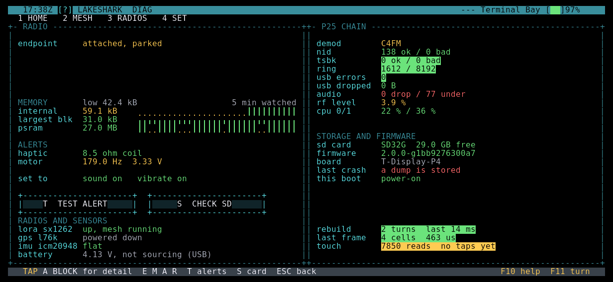

# DIAG

What the hardware is doing: memory, alerts, radios and sensors, the SD card,
the P25 decoder and the error log.

| | |
|---|---|
| HOME group | SYSTEM |
| Radio | None of its own. It reports on all of them |

## What it does

DIAG is the health page. It shows memory with a short history, the alert
motor and sound, each radio and sensor, the SD card, the firmware build and
how this boot started. It also keeps the error log: each crash, watchdog
reset or brownout is saved at the next boot, with the last log lines before
it.

DIAG only reads. It changes nothing on the board except when you test the
alerts, check the card or clear the error log.

## Radio

None. DIAG does not use a radio. It reports what the USB SDR, the LoRa chip
and the GPS receiver are doing.

## How to use it

| Key | Touch | Action |
|---|---|---|
| E | Tap the RADIO block | Open ENDPOINT detail |
| M | Tap MEMORY | Open MEMORY detail |
| A | Tap ALERTS | Open ALERTS detail |
| R | Tap RADIOS AND SENSORS | Open RADIOS AND SENSORS detail |
| L | Tap L LOG | Open the ERROR LOG |
| T | T TEST ALERT | Post a test notice. With alerts on, it rings and buzzes |
| S | S CHECK SD | Mount and check the SD card |
| Esc, Backspace | ESC BACK | Close a detail page; on the main page, back to HOME |

In the ERROR LOG:

| Key | Touch | Action |
|---|---|---|
| N, Right, Down | N NEXT | Next saved record, then this run |
| Left, Up | | Previous record |
| C, then C again | C CLEAR | Clear the saved log. Esc cancels |

## What the screen shows

The left half shows the main blocks, or one detail page when it is open. The
right half always shows the decoder and storage.

- **RADIO**: the USB radio endpoint, its state, throughput, stall time,
  recoveries and attach count. With nothing streaming it reads "attached,
  parked", "declared, not plugged in" or "none attached".
- **MEMORY**: free internal RAM, the largest free block and free PSRAM, each
  with a trace. The heading shows the lowest internal free memory ever seen
  and how long the traces cover.
- **ALERTS**: the haptic motor coil and frequency, any motor fault, and
  whether sound and vibrate are on.
- **RADIOS AND SENSORS**: the LoRa chip and its session, the GPS receiver
  (fix, searching or silent, with satellites), the motion sensor's pose and
  the battery voltage and current.
- **P25 CHAIN**: decoder state, demodulator, good and bad frame counts, the
  sample ring, USB errors and drops, audio drops and underruns, RF level and
  CPU load per core.
- **STORAGE AND FIRMWARE**: SD card result and free space, firmware version,
  board, the error log count with its newest entry, and why this boot started.
  IN SAFE MODE appears when the board started in safe mode.
- At the bottom: the last screen rebuild, the cost of the last frame and touch
  reads and taps.

Green is good, yellow is worth a look and red means a counter has moved at
some point. Counters add up over the session.

The ERROR LOG shows each saved record, newest first: its number, when, why,
the firmware it ran, where it stopped and its last log lines. After the
records, THIS RUN SO FAR shows errors and warnings from the current session.

## Tips and limits

- After a crash, press L in DIAG to see what the board was doing.
- The SD card line reads "unchecked (S)" until you press S.
- Memory traces cover only the time the screen has been running, not full
  uptime.

## More guides

- [TERMINAL](TERMINAL.md)
- [RADIOS](RADIOS.md)
- [Controls and navigation](../UI_CONTROLS.md)
- [All apps](README.md)
