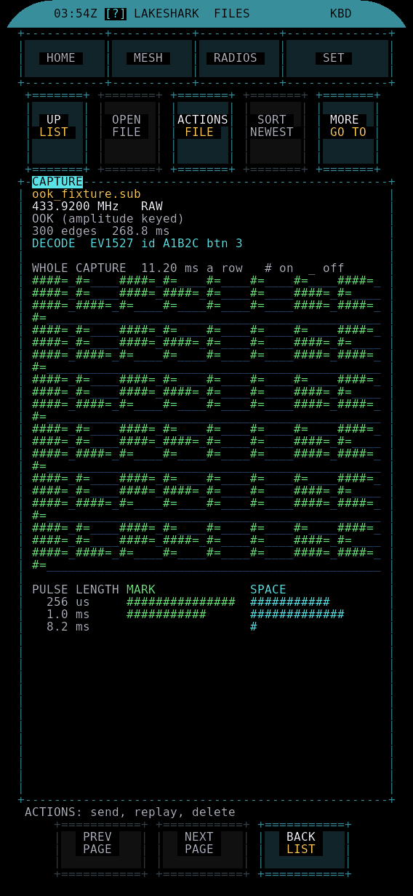

# FILES

Browse the SD card, look inside sub-GHz captures and text files, and send, rename or delete them.

| | |
|---|---|
| HOME group | RADIO |
| Radio | None. Replay hands a capture to REC |

## What it does

- Lists the folders and files on the SD card, starting at `/sdcard`.
- Opens a `.sub` capture as a picture: frequency, modulation, a whole-capture overview, pulse lengths and a decode where the encoding is known.
- Opens text files (notes, logs, tracks, CSV) for reading.
- Copies a capture to the folder the Flipper LakeShark app reads.
- Hands a capture to REC for replay.
- Renames and deletes files and empty folders.

FILES records nothing and does not use GPS.

## Radio

FILES uses no radio itself. REPLAY opens the capture in REC (RECORD), which uses the transmitter that suits the file.

## How to use it

Open **HOME > RADIO > FILES**.

### Buttons along the top

| Button | Key | Does |
|---|---|---|
| UP / BACK (FOLDER or LIST) | U, Backspace or Esc | Up one folder, or back to the list from a file |
| OPEN (FOLDER or FILE) | O or Enter | Open the selected folder or file |
| ACTIONS (FOLDER or FILE) | A | What can be done with it |
| SORT | S | Choose the order |
| OPTIONS (SHOW / GO TO) | M | Filter, jump to a folder, refresh, card space |

- Up / Down move through the list, or scroll an open file.
- Left / Right or Tab move between the top buttons. Enter presses the highlighted one.
- Touch: tap a row to select it, tap it again to open it.
- In portrait, and in the text view, a bottom bar adds PREV PAGE, NEXT PAGE and BACK.
- At the top of the card, BACK leaves FILES. If REC sent you here to pick a file, BACK returns to REC.

### SORT

Folders always come first. Files can be sorted by NAME, NEWEST (the default), OLDEST, LARGEST or TYPE (grouped by extension).

### ACTIONS

The list depends on the file:

- **SEND TO FLIPPER** (`.sub` only): copies the capture to the REC folder on the card. On the Flipper it appears under LakeShark > FILES. A name already in use gets a number added.
- **OPEN CAPTURE / REPLAY** (`.sub`, from the list): loads the capture, then shows the actions again.
- **REPLAY** (`.sub`, in the capture view): opens it in REC (RECORD). OOK captures use the CC1101, CC1101 FSK captures use the CC1101 in FSK, and other FSK captures use the LoRa radio.
- **REPLAY REFUSED** or **REPLAY UNAVAILABLE**: shown with the reason when a capture cannot be replayed.
- **VIEW AS TEXT**: shows the file as written.
- **INFO**: type, exact size, modified date and folder.
- **RENAME**: type a new name. Normal FAT name rules apply.
- **DELETE**: asks first. A folder can be deleted only when it is empty. A deleted file cannot be brought back.

### OPTIONS

M or the OPTIONS button opens the list. BACK goes up one level.

- **SORT**: change the order. Left / Right step through the choices.
- **CAPTURES**: jump to the REC captures folder, the one the Flipper reads.
- **SUB-GHZ**: jump to SUB-GHZ watch exports and archives.
- **JOURNAL**: jump to field notes and tracks.
- **CARD ROOT**: jump to `/sdcard`.
- **SHOW**: ALL, .SUB, IMAGES or TEXT. Left / Right step through the choices.
- **REFRESH**: read the folder again. Mounts the card if it was not mounted.
- **CARD SPACE**: shows free and total space on the card.

## What the screen shows

**List.** The current folder path at the top left and the sort and filter at the top right. Folders are yellow, `.sub` captures green, other files white. Each row shows the date and size. The panel title shows how many entries are listed.

**Capture view** (`.sub`):

- File name, frequency in MHz and protocol.
- Modulation: OOK, or 2-FSK with baud rate, deviation and sync word.
- Number of edges and the length of the capture.
- DECODE: the decoded value when the pulses match a known encoding, or "no known encoding".
- WHOLE CAPTURE: the entire recording drawn row by row. `#` means the carrier was on, `_` off.
- PULSE LENGTH: how long the marks and spaces are, on a doubling scale.

**Text view.** The file a page at a time, with the byte range in the title. Characters the screen cannot draw show as `?`.

## Tips and limits

- Text view opens `.txt`, `.csv`, `.gpx`, `.json`, `.log`, `.md`, `.ini`, `.cfg`, `.nmea` and `.sub`.
- Other files show their name and size, with no viewer. Images are listed but not previewed.
- Captures and copies are limited to 1 MB.
- A folder shows up to 256 entries. A larger folder shows the first 256 in the chosen order.
- Files whose names start with a dot are hidden.
- A date of "no date" means the clock was not set when the file was written.
- Reading a big folder, loading a capture or copying shows progress. BACK or a tap cancels it.
- WAV files play in [MUSIC](MUSIC.md), from `/sdcard/music`.

## More guides

- [Controls and navigation](../UI_CONTROLS.md)
- [Replay and aircraft](../REPLAY_AND_AIRCRAFT.md)
- [REC](REC.md)
- [All apps](README.md)
