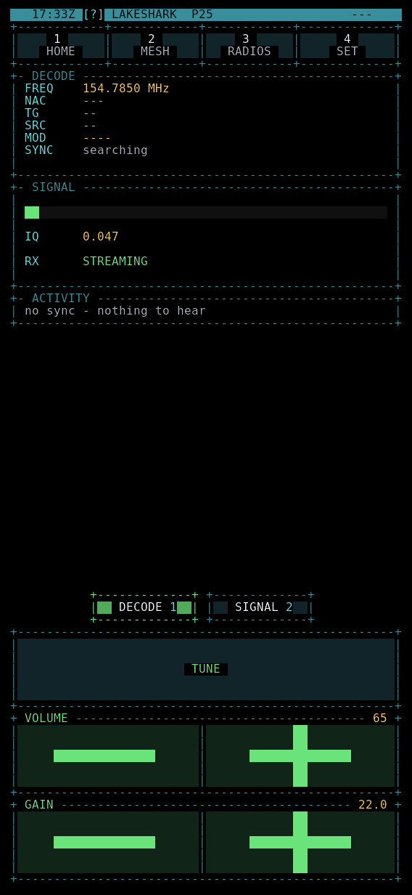

# P25

Listen to P25 radio: follow a trunked control channel, decode Phase 1 voice and see which talkgroups are active.

| | |
|---|---|
| HOME group | RADIO |
| Radio | RTL-SDR or HackRF; LR2021 for Phase 1 voice |

## What it does

- Tunes one channel and decodes P25 Phase 1 (C4FM, with CQPSK settings for an SDR).
- Follows trunking grants from a control channel to the voice channel.
- Plays clear voice through the speaker. Encrypted voice stays muted.
- Lists every talkgroup heard, with how often and how recently.
- Loads a system profile from the SD card.
- Records calls to the SD card through CALLS.
- Shows DMR Tier II call activity on its own page.

## Radio

RADIO on R opens the radio picker. P25 runs on an RTL-SDR or a HackRF in the USB-A port. A board with the LR2021 can decode Phase 1 voice without an SDR. The LR2021 gives symbols rather than a spectrum, so SPECTRUM and Phase II need an SDR.

## How to use it

Keys and buttons on the main page:

| Key | Button | Action |
|---|---|---|
| Left / Right | | Tune down or up 12.5 kHz |
| T | TUNE | Type a frequency |
| + / - | VOLUME | Volume |
| U / J | GAIN | Receiver gain up or down. On the LR2021 this picks AUTO or MAX |
| 1 | | Back to the decode page |
| 2 | SPECTRUM | Spectrum on or off |
| 3 | SCAN | Channel scanner |
| 4 or P | SETTINGS | Opens OPTIONS (on SPECTRUM, P changes COLOR) |
| 5 | CALLS | Recorded calls |
| 6 | DMR | DMR activity page |
| R | RADIO | Choose the receiver |
| O | OPTIONS | P25 settings |
| L | | Choose a profile from the card |
| N | | Save a site note to the journal |
| Esc or 0 | | Back to the decode page |

Every button can also be tapped. On a short portrait screen the controls become TUNE, VOL-, VOL+, GAIN- and GAIN+ (AUTO and MAX on the LR2021).

On SPECTRUM, Left and Right move a marker and Space tunes to it. Tap a signal to mark it. The waterfall keys are listed in [Controls and navigation](../UI_CONTROLS.md).

SCAN opens the shared scanner: SCAN, TUNE, LISTS, SETTINGS and MORE. Inside its lists R is RANGE and O is SCAN TYPE.

### OPTIONS

O, P, 4 or SETTINGS opens the list. BACK goes up one level. Main rows:

- "Call archive": recording and playback settings for CALLS.
- "Talkgroup policy": "Hold current talkgroup", "Lockout current talkgroup", "Lockout list", "Allow list mode" (ALL, ALLOW ONLY, FOLLOW NONE) and the allowed list. Talkgroups are numbers from 1 to 65535.
- "Control survey": ENTER starts a control channel survey, and ENTER again cancels it.
- "Demodulation", "Polarity", "Automatic gain" and "Receiver gain (dB)" (0 to 50 on an SDR, AUTO or MAX on the LR2021).
- "Volume", "Voice gate" (0 to 99) and "Sync beep".
- "Trunking auto-follow", "Leave encrypted calls" and "Encrypted skip (s)".
- "Scan threshold (%)" and "Scan hang (ms)".
- "Phase II (exp)" and "Phase II follow (exp)": experimental, SDR only.
- "Profile from card": same as L.
- CQPSK timing and carrier gain, and "Reset CQPSK tuning": SDR only.

### Profiles

Put files named `p25_profile*.txt` in the root of the SD card. L, or "Profile from card", lists them with the `system=` line from each file. Choose one to load it. Its control channels then appear under BAND in FALLS.

## What the screen shows

- **P25 / RECEIVER**: the frequency in large digits and the receiver state.
- **DECODE / SIGNAL**: NAC, talkgroup (TG), source unit (UNIT), modulation (MOD), sync state, a signal gauge, the IQ level (RSSI on the LR2021), RX STREAMING or STOPPED, and the audio state. IQ shows CLIP with a percentage when the gain is too high.
- Sync states include CONTROL SEARCH, CONTROL LOCKED, GRANT / TRAFFIC WAIT, TRAFFIC SYNC, VOICE and ENCRYPTED.
- **ACTIVITY**: each talkgroup heard, how many times, how long ago, and where it was seen: L (link control), H (header) or G (grant). Rows heard in the last 30 seconds are bright. A frequency appears when the talkgroup was heard on a different channel.
- **RECEIVER HEALTH / TOTALS** when there is room: data rate, sync and voice counts, BCH results, drops and decode time.

The DMR page shows DMR TIER II / RECEIVE ONLY, one pane per slot with colour code, talkgroup, source and call length. SLOT (S) picks BOTH, 1 or 2. HOLD (H) holds the destination of a live call. 1 or Esc returns to P25. DMR voice playback and recording are not available.

## Tips and limits

- "no sync - nothing to hear" means nothing is being decoded. "synced, nothing heard yet" means a quiet system.
- Strong nearby transmitters can overload an RTL-SDR. Lower the gain if IQ shows CLIP.
- The site note records where the board was, not where the transmitter is.
- CALLS needs an SD card. Encrypted audio is not recorded.
- Phase II is experimental. See [P25 Phase II](../P25_PHASE2.md).

## More guides

- [P25 voice](../P25_VOICE.md)
- [P25 Phase II](../P25_PHASE2.md)
- [GPS scanning and list imports](../LOCATION_SCAN.md)
- [Updates and calls](../TDP4_UPDATES_AND_CALLS.md)
- [Controls and navigation](../UI_CONTROLS.md)
- [All apps](README.md)
