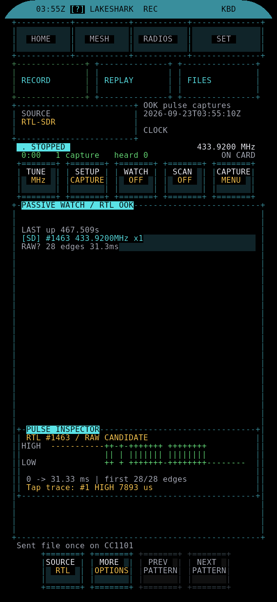

# REC

Capture what a radio receives and save it to the SD card, then replay a saved capture.

| | |
|---|---|
| HOME group | FIELD |
| Radio | Signal captures: RTL-SDR, CC1101 or the LoRa chip. Readings as CSV: HackRF, nRF24, NFC, Wi-Fi, Bluetooth or mesh traffic. Position track: GPS |

## What it does

- **RECORD** saves what the chosen radio hears. What gets written depends on the radio:
  - RTL-SDR and CC1101: OOK pulse captures.
  - LoRa chip: FSK captures.
  - HackRF, nRF24, NFC, Wi-Fi and Bluetooth: that radio's readings as CSV.
  - Mesh traffic: a CSV of what MeshCore hears.
  - GPS: a position track.
- Signal captures are Flipper-compatible sub-GHz files.
- While a CSV recording runs, a `samples.csv` row is written every second with position, motion and signal.
- **REPLAY** loads a capture picked in FILES. It shows the frequency, a pulse preview and the nominal power. PLAY ONCE sends it one time.
- **FILES** opens the FILES app to pick a capture.

## Radio

Press R (or U), or tap the RADIO box at the top left, to open the RADIO picker. Every radio is listed with the job it does here, or the reason it cannot be used right now. A **Mesh traffic** row sits below the radios.

- The RTL-SDR and HackRF go in the USB-A port.
- The CC1101, nRF24 and NFC need the T-MixRF keyboard board.
- Bluetooth must be turned on in RADIOS.
- FSK captures need a LoRa chip with an FSK receiver.

REC and SUB-GHZ share one capture receiver. A capture radio chosen in REC is the one SUB-GHZ uses too, and REC always names the one actually in use.

The radio cannot be changed while WATCH, SCAN, LEARN, a replay, a CSV recording or a GPS track is running. REC says which one to stop first.

## How to use it

Open **HOME > FIELD > REC**. Tap a tab, or press Tab to switch between RECORD and REPLAY.

### RECORD

The view below the RADIO box follows the radio. The hint line at the bottom shows its keys.

| Radio | Keys |
|---|---|
| RTL-SDR, CC1101, LoRa chip | W starts or stops WATCH. D opens READ RAW (RTL-SDR or HackRF source). O opens FILES |
| HackRF, nRF24, NFC, Wi-Fi, Bluetooth, mesh traffic | C turns RECORD (CSV) on or off. V shows the live SENSORS readings. O opens FILES |
| GPS | T starts or stops the GPS track. M opens the map. O opens FILES |

Capture radios show the SUB-GHZ capture pages inside REC: frequency, capture setup, WATCH and the captured patterns. They work the same as in the SUB-GHZ app.

**READ RAW** is the manual capture page. Press ARM, or Enter, to wait for the next signal over the trigger. Press STOP to end it.

### REPLAY

1. Open FILES (O, or the FILES tab), select a `.sub` capture and choose REPLAY. REC opens on REPLAY with the file loaded. Loading does not transmit.
2. Check the radio, format, frequency, length and nominal power.
3. Set the power with POWER- and POWER+.
4. Press PLAY ONCE.

| Button | Key | Does |
|---|---|---|
| PLAY ONCE | P or Enter | Sends the capture one time |
| POWER- / POWER+ | - and + | Steps the transmit power |
| BROWSE FILES | O | Opens FILES to pick another capture |

- Left / Right select a pulse in the preview. A tap on the preview selects the pulse under it.
- OOK captures and CC1101 FSK captures replay on the CC1101 at -10, 0, +5 or +10 dBm.
- Other FSK captures replay on the LoRa chip at -9, 0, +5 or +10 dBm.

## What the screen shows

- **RECORD**: the RADIO box, what that radio records (for example "OOK pulse captures"), and the clock.
- **READ RAW**: CAPTURE START time, then state (idle, armed, CAPTURING, done), frequency, receiver (streaming or stopped), captures, edges and free card space.
  - **LEVEL**: the received level over time. The yellow dashed line is the trigger. Samples at or over the trigger are red.
  - **RX RATE**: how fast samples arrive from the receiver, in KiB/s. This is receiver input, not card writes.
  - The footer names the folder captures go to.
- **REPLAY**: file name, frequency, RAW OOK or RAW FSK, nominal power, length and edge count. STORED PULSES draws the first 128 edges as HIGH and LOW. Yellow marks the selected pulse. A white line with a blue trail shows the send is working. The status line reports the result.

## Tips and limits

- Stop WATCH before changing the radio or the frequency.
- The capture file itself carries no position. Position goes into the `samples.csv` rows of a CSV recording.
- One PLAY ONCE is one bounded send. Wait for the result line before sending again.
- CSV recordings and their files live under `/sdcard/journal`.

## More guides

- [Replay and aircraft](../REPLAY_AND_AIRCRAFT.md)
- [Field and lab guide](../FIELD_LABS.md)
- [MIX-RF keyboard radios](../MIX_RF.md)
- [Controls and navigation](../UI_CONTROLS.md)
- [All apps](README.md)
